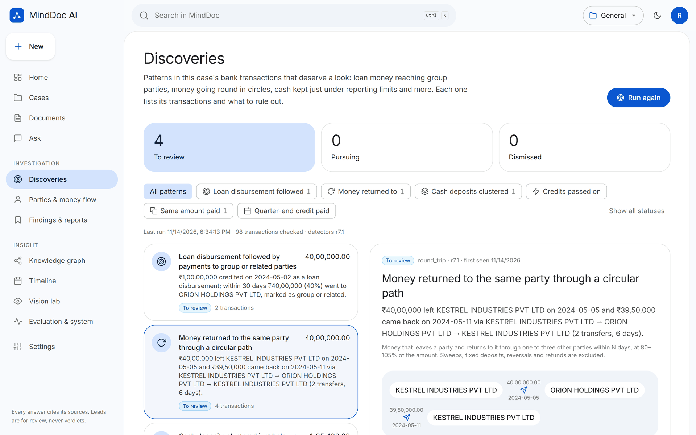
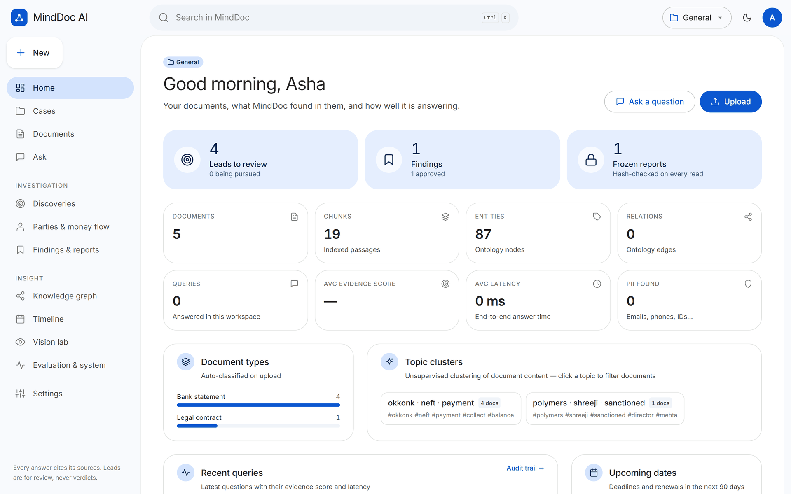
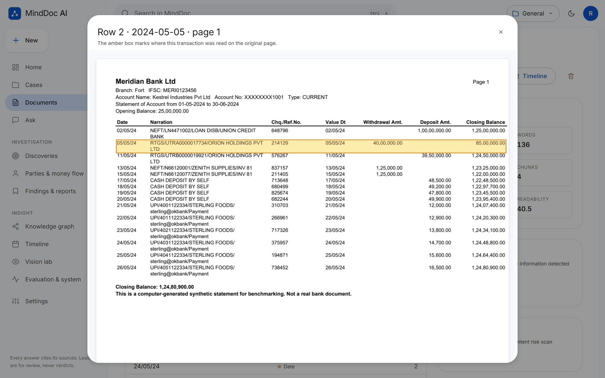
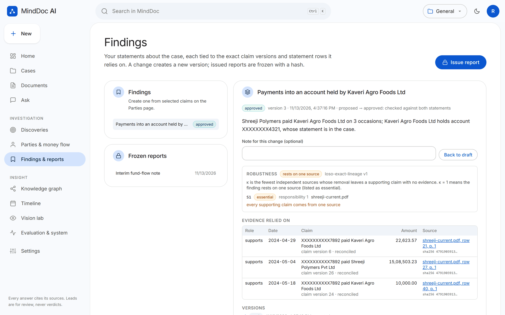
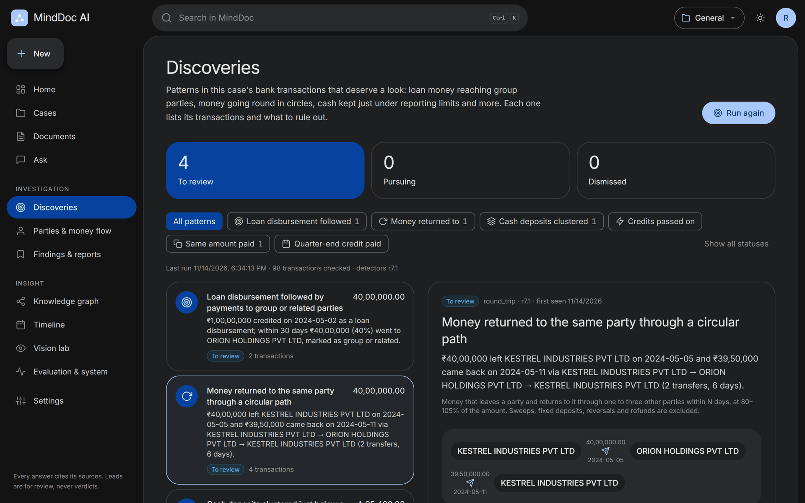
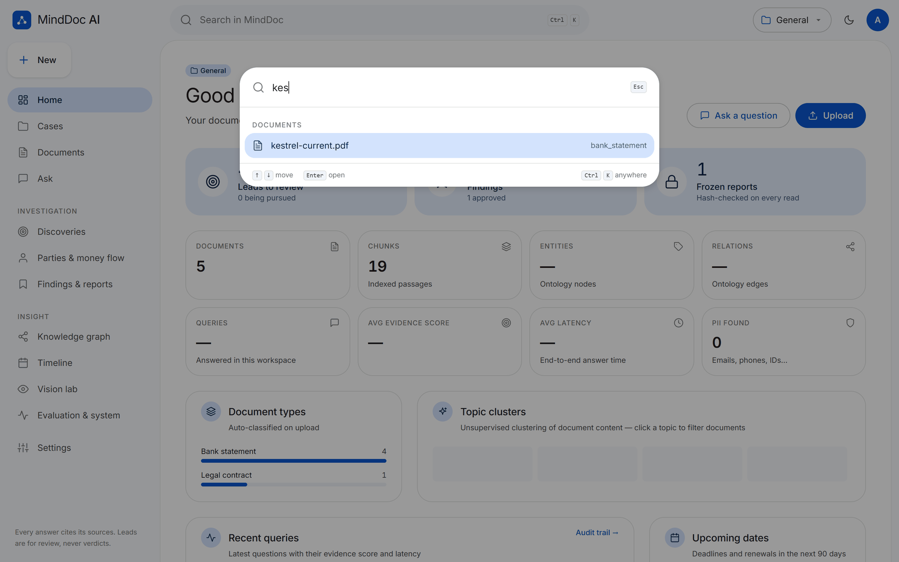
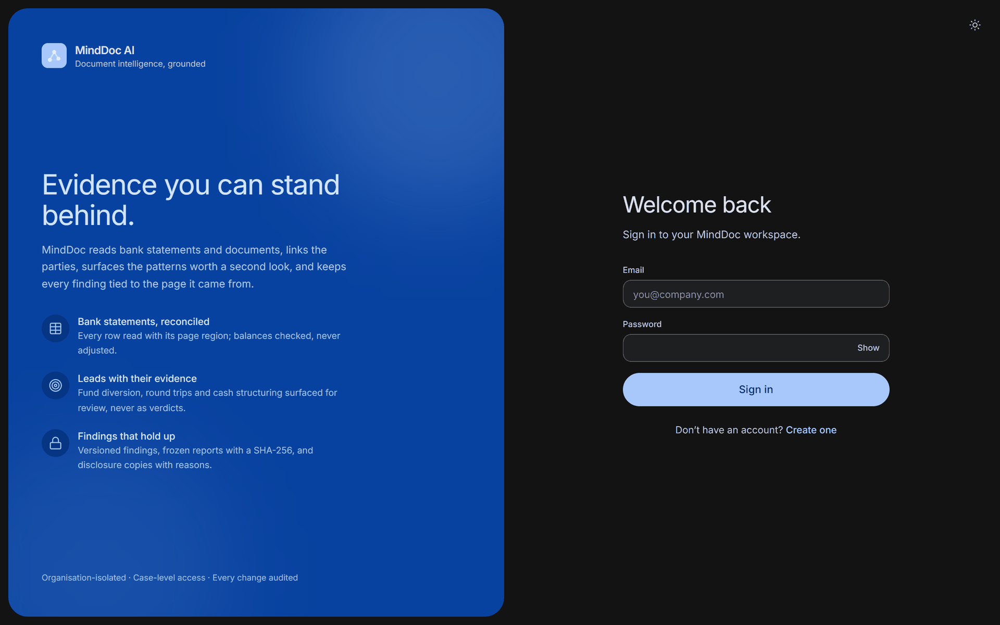
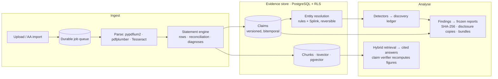

<div align="center">


# MindDoc AI

**Evidence-grade financial document intelligence.**<br/>
Reads bank statements and case documents, resolves the parties behind every transfer, surfaces the patterns worth
a second look, and keeps every finding tied to the exact row on the exact page it came from.

[](https://github.com/Nitant28/MindDoc-AI/actions/workflows/ci.yml)


[**Live demo**](https://mind-doc-ai.vercel.app) · [Product context](docs/PROJECT_CONTEXT.md) · [Architecture](docs/ARCHITECTURE.md) · [Benchmarks](benchmarks/reports) · [API](docs/API_CONTRACT.md)

<br/>



</div>

---

## Why MindDoc

A lender's forensic review, a wilful-default inquiry or an end-use audit comes down to the same three questions:
*where did the money go, who is really behind each counterparty, and can every claim in the report be defended
line by line?* Spreadsheets lose the provenance; black-box "fraud scores" cannot be defended.

MindDoc is built the other way round:

- **Nothing without a source.** Every number is read from a page region, reconciled against running balances and
  stored with its box, its document's SHA-256 and the engine version. Values are never adjusted to make balances
  agree.
- **Leads, never verdicts.** Detectors flag patterns for a human, list the transactions behind each one and say
  what to rule out first. Detectors, findings and reports never label fraud or intent.
- **Decisions are versioned.** Party merges, findings and reports are append-only and reversible, so the state of a
  case can be replayed as it stood on any day.

## What it does

<table>
<tr>
<td width="50%" valign="top">

**📄 Statements, reconciled**<br/>
A layout-generic engine reads text-layer and scanned PDFs (Tesseract on word boxes) and Account Aggregator data,
then reconciles every row and ranks hypotheses for each break: a misread digit, a missing row, a swapped direction.

**🧭 Parties and money flow**<br/>
Counterparties come from UPI, NEFT, RTGS and IMPS narrations and are resolved with validated identifiers and Splink.
Uncertain pairs wait in a review queue; every merge carries its evidence and can be undone.

**🎯 Discoveries**<br/>
Six deterministic detectors find:
- loan money reaching group or related parties;
- round trips;
- cash kept just under reporting thresholds;
- pass-through accounts;
- duplicate payments;
- quarter-end window dressing.

Every lead keeps its disposition across re-runs.

</td>
<td width="50%" valign="top">

**🔖 Findings that hold up**<br/>
Analyst findings are pinned to specific claim versions. A leave-one-source-out check shows which sources a finding
stands on. Reports are frozen as canonical JSON with a SHA-256 hash and re-verified on every read.

**🔒 Disclosure-ready**<br/>
Disclosure copies withhold third parties' personal data, with a reason recorded for each item (*SBI v. Amit Iron*,
2026). Evidence bundles contain row images, sources and a SHA-256 manifest.

**💬 Cited answers**<br/>
Hybrid retrieval inside PostgreSQL (pgvector, full-text search and BM25) feeds streamed answers. Each answer
sentence is checked against its source by a verifier that recomputes the arithmetic.

**🏢 Built for teams**<br/>
- organisations and cases with roles (viewer, analyst, reviewer, lead);
- row-level security on every tenant table;
- a hash-chained audit trail.

</td>
</tr>
</table>

## A look inside

| | |
|---|---|
|  |  |
| **Home:** the selected case at a glance, from live data | **Provenance:** every transaction opens on its page, boxed |
|  |  |
| **Findings:** versioned, pinned to claim versions, with robustness | **Dark mode:** follows the system; switch at any time |
|  |  |
| **Ctrl K:** jump to any page, case, document or action | **Organisations:** invite-only teams, case-level access |

<sub>Screenshots are from a local instance with synthetic statements generated for benchmarking. No real customer data.</sub>

## Architecture



- **Modular monolith** (FastAPI) with a durable job table (claim, lease, heartbeat, dead-letter): an upload returns
  at once (HTTP 202) and analysis runs in workers.
- **PostgreSQL as the system of record:** Alembic migrations, a non-owner application role and **forced row-level
  security** on every tenant table. Append-only tables (identity events, findings, reports, audit) cannot be
  rewritten by the application role. SQLite is kept as a single-user development fallback.
- **Exact money:** integer paise everywhere in the finance code, enforced by a no-float guard in CI.
- **Licence-clean by policy:** no AGPL, GPL or non-commercial components in the shipped image. The slim build has
  no torch.

The decisions behind each choice are recorded in [docs/adr](docs/adr).

## Measured, not claimed

Each benchmark has a held-out split scored once, from a committed tree, after its criteria were committed.
Everything below is **synthetic and from the same authors as the code**; real-world accuracy is not yet measured.

| Benchmark | What it measures | Held-out result |
|---|---|---|
| [StatementBench](benchmarks/reports/STATEMENTBENCH.md) | text-layer statements, unseen layouts | row F1 **1.000**, statements exact **1.000** |
| StatementBench-Scan | scanned statements (mild / rough) | row F1 **0.999** / **0.904**; **0** silent errors in 120 |
| StatementBench v1 | injected faults: detection and localisation | **0 / 300** false alarms; detection **1.000** |
| [EntityBench](benchmarks/reports/ENTITYBENCH.md) | party resolution | auto-merge precision **0.979**, **0** high-risk wrong merges (auto recall 0.578) |
| [HB-Synth v2](benchmarks/reports/HALLUCINATION_BENCHMARK.md) | claim verifier on unseen documents | catches **74%** of planted errors; wrongly flags **21%** of correct sentences |
| [RetrievalBench-Synth](benchmarks/reports/RETRIEVALBENCH.md) | search inside PostgreSQL vs in-process | hybrid Hit@5 **0.782** in PostgreSQL vs **0.775** in-process; dense rankings identical |
| [FB-Synth v0](benchmarks/reports/FBSYNTH.md) | discovery detectors | scheme recall **0.976**; **1.38** false flags per 10 benign look-alikes (target ≤ 1, not met) |

Where a target was missed, the report says so and explains why.

## Quick start

```bash
# backend: Python 3.11 (slim profile, no torch)
pip install -r requirements.txt
cp .env.example .env            # set JWT_SECRET; LLM keys are optional, everything works offline
python run_server.py            # http://127.0.0.1:8000/docs
```

```bash
# frontend
cd frontend && npm install && npm run dev      # http://127.0.0.1:5173
```

```bash
# or everything in one container
docker build -t minddoc . && docker run -p 8000:8000 --env-file .env minddoc
```

**PostgreSQL:** set `DATABASE_URL=postgresql+pg8000://…`; migrations and row-level security are applied at
startup. See [docs/DEPLOYMENT.md](docs/DEPLOYMENT.md).

**Tests:**
- `python -m pytest -q` runs offline on an isolated database.
- `TEST_DB=postgres python -m pytest -q` runs the same suite on PostgreSQL with row-level security.

**LLM providers:** Claude, OpenAI or Azure, OpenRouter, Gemini, NVIDIA NIM, DeepSeek or a local Ollama, chosen with
`LLM_PROVIDER_ORDER`. With none configured, MindDoc still extracts, reconciles, resolves, detects and verifies; only
free-text answers need a model.

## Repository map

```
app/
  api/          REST + SSE: auth, team, cases, documents, chat, parties, findings, reports, discoveries
  finance/      exact money, statement engine, OCR repair, identifiers (PAN, GSTIN, IFSC), Account Aggregator
  identity/     narrations → parties, Splink resolution, reversible merges, transfer claims
  discovery/    deterministic detectors and the discovery ledger
  findings/     versioned findings, frozen reports, fragility, disclosure copies, evidence bundles
  cases/        organisations, case roles and document visibility
  ai/  ml/      retrieval, claim verifier with recomputation, knowledge graph, LLM gateway
  database/     SQLAlchemy models, tenancy and row-level security plumbing
migrations/     Alembic: 0001 baseline → 0011 discovery ledger
benchmarks/     generators, runners and reports for every metric above
frontend/       React 18 + TypeScript + Tailwind (Material 3-style design system)
docs/           ADRs, architecture, design reviews, deployment, manual, status log
```

## Project status

MindDoc is pre-release. [docs/IMPLEMENTATION_STATUS.md](docs/IMPLEMENTATION_STATUS.md) is the honest execution log,
listing what is built, measured, not done, or waiting on an owner decision.

Main open items:
- accuracy on real statements, which needs a data agreement;
- independent annotators for the claim benchmark;
- a persistent hosted database for the demo (the live demo resets on every deploy);
- market validation interviews.

## Contributing and security

See [CONTRIBUTING.md](CONTRIBUTING.md) for how changes are made: small commits, tests first, benchmarks scored once.

Report vulnerabilities privately as described in [SECURITY.md](SECURITY.md).

No open-source licence has been granted yet; all rights are reserved by the owner.
