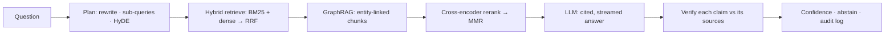

# MindDoc AI

**Glass-box document intelligence.** Upload contracts, scans, invoices, papers or photos of documents. MindDoc
*sees* them (computer vision + OCR), *understands* them (ML analytics + a knowledge graph), and *answers* questions
with evidence you can check: numbered citations highlighted on the original page, a per-claim support check,
a calibrated confidence score, and a full reasoning trace.

It runs with Claude, OpenAI/Azure, Gemini, NVIDIA NIM, DeepSeek or a local Ollama model. It also runs **fully
offline**, with no LLM at all.

---

## What's inside

| | Capability | Techniques |
|---|---|---|
| 👁 **Computer Vision** | scanned-page OCR, quality gating, layout | variance-of-Laplacian blur score, NL-means denoise, CLAHE, deskew (minAreaRect), adaptive threshold, morphological text/table/figure detection, Tesseract + EasyOCR (CRAFT + CRNN) with confidence, vision-LLM captions, **pixel-level citation highlights** |
| 📈 **Machine Learning** | search, analytics, evaluation | BM25, dense embeddings (MiniLM), Reciprocal Rank Fusion, cross-encoder reranking, MMR, zero-shot classification, KeyBERT-style keyphrases, K-Means + c-TF-IDF topics, extractive summaries, readability, self-supervised Hit@5/MRR with ablations |
| ✨ **Generative AI** | grounded answers and extraction | agentic RAG (rewrite → decompose → HyDE → retrieve → GraphRAG → rerank → generate → verify), streamed cited answers, claim-level groundedness + LLM-as-judge, abstention, calibrated confidence, schema-driven JSON extraction, GraphRAG-style entity + relation extraction, multi-provider gateway with circuit breaker |
| 🛡 **Responsible AI** | trust and safety | PII detection (Luhn-validated cards, SSN, IBAN, PAN/Aadhaar…), indirect prompt-injection detection + context sanitisation, per-user workspace isolation, audit trail with prompt hashes, rate-limited auth, PBKDF2-310k |

## Quick start

```bash
pip install -r requirements.txt
cp .env.example .env          # set JWT_SECRET; add any LLM key (optional)
python run_server.py          # API → http://127.0.0.1:8000/docs
```
```bash
cd frontend && npm install && npm run dev     # UI → http://127.0.0.1:5173
```
Or run everything in one container: `docker build -t minddoc . && docker run -p 8000:8000 --env-file .env minddoc`

Tests (offline, isolated DB): `python -m pytest tests -q`

## How an answer is made



## Documentation

| Doc | For |
|---|---|
| [docs/MANUAL.md](docs/MANUAL.md) | install, configure providers, use every screen, troubleshooting |
| [docs/CONCEPTS.md](docs/CONCEPTS.md) | every CV / ML / GenAI concept explained, with file pointers and interview lines |
| [docs/ARCHITECTURE.md](docs/ARCHITECTURE.md) | system design, data model, design decisions, security, scaling path |
| [docs/API_CONTRACT.md](docs/API_CONTRACT.md) | REST + SSE API reference |
| [docs/ROADMAP.md](docs/ROADMAP.md) | product strategy, vertical positioning, roadmap, 3-minute demo script |
| [docs/research/HACKATHON_WINNERS_RESEARCH.md](docs/research/HACKATHON_WINNERS_RESEARCH.md) | Microsoft / Google / NVIDIA winners analysis and Palantir principles |

## Project layout

```
app/
  api/        auth · documents · chat (JSON + SSE) · intel (graph, timeline, audit, eval) · vision
  ai/         llm gateway · rag pipeline · knowledge graph · extraction · guardrails
  ml/         embeddings · hybrid retrieval · insights · evaluation
  vision/     CV pipeline · page highlighter
  services/   parsing · ingestion orchestration
  database/   SQLAlchemy models + auto-migration
frontend/     React + TypeScript + Tailwind
tests/        unit + end-to-end API tests
docs/         manuals, architecture, research, roadmap
```
