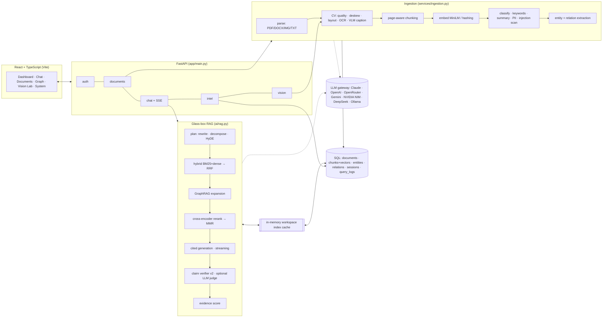
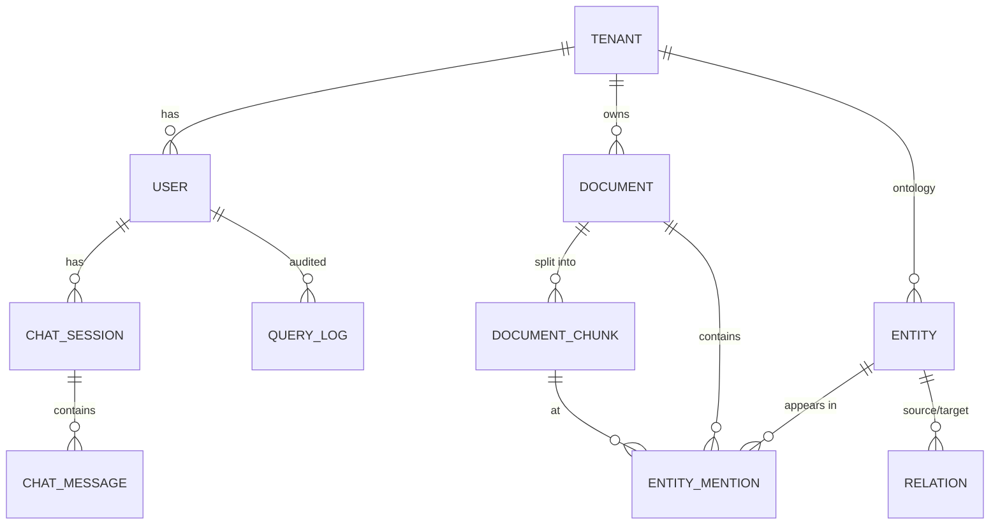

# MindDoc AI — Architecture (current code, v2.1.0)

> This describes what is running now. The target architecture (Postgres, claim-centric evidence model, workers,
> investigation engine) is a proposal in `architecture/SYSTEM_ARCHITECTURE.md` and the ADRs in `adr/`.

## 1. System overview

## 2. Module map

| Layer | File | Responsibility |
|---|---|---|
| API | `app/api/auth.py` | register (private workspace per user), login, `/me`, rate limiting |
| | `app/api/documents.py` | upload → ingest, list, detail (lazy v1 backfill), structured extract, delete |
| | `app/api/chat.py` | `/query` (JSON) and `/stream` (SSE), sessions, history, saved items |
| | `app/api/intel.py` | knowledge graph, overview analytics + topics, date timeline, audit trail, retrieval eval, capabilities |
| | `app/api/vision.py` | Vision Lab: single-image CV inspection |
| Ingestion | `app/services/document_service.py` | multimodal parsing, page-level OCR fallback, tables → Markdown |
| | `app/services/ingestion.py` | orchestration, dedup by SHA-256, analytics, graph build, index invalidation |
| Vision | `app/vision/cv.py` | quality, preprocessing, layout, OCR, captions, annotation |
| | `app/vision/highlight.py` | pixel-level citations: render a PDF page with the cited passage boxed |
| ML | `app/ml/embeddings.py` | embedding + reranker singletons, hashing fallback |
| | `app/ml/retrieval.py` | BM25, dense, RRF, MMR, per-workspace cached self-healing index |
| | `app/ml/insights.py` | chunking, keywords, zero-shot classification, summaries, topics, readability |
| | `app/ml/evaluation.py` | self-supervised hit-rate/MRR with ablations |
| GenAI | `app/ai/llm.py` | provider gateway, streaming, JSON mode, vision, circuit breaker |
| | `app/ai/rag.py` | agentic RAG pipeline with trace, verification, confidence, audit log |
| | `app/ai/knowledge.py` | ontology extraction, entity resolution, graph queries, GraphRAG-lite |
| | `app/ai/extraction.py` | schema-driven JSON extraction |
| | `app/ai/guardrails.py` | PII, prompt-injection detection/sanitisation |
| Data | `app/database/models.py` | SQLAlchemy models + additive auto-migration for SQLite |

## 3. Data model

- `document_chunks.embedding` stores a JSON vector plus `embedding_model` and `page`.
- `chat_messages.meta_json` stores citations, confidence, groundedness and trace per answer (full provenance).
- `query_logs` is the audit trail (who asked what, which model, latency, confidence, groundedness).

## 4. Key design decisions

| Decision | Why | Trade-off / upgrade path |
|---|---|---|
| In-memory NumPy index per workspace, fingerprinted by (count, max id, model) | zero infra, sub-ms search for ≤100k chunks, auto-invalidation | swap for pgvector / Qdrant / FAISS when a workspace exceeds ~200k chunks |
| Hybrid retrieval + RRF instead of dense-only | exact identifiers + paraphrases both matter in business docs | measured by `/intel/eval` ablation |
| Plain-HTTP LLM gateway | no SDK drift; one code path for 6 providers; offline mode | provider-specific features (prompt caching, tool use) can be added per adapter |
| Extractive fallback when no LLM | demo never dies; privacy mode with zero data egress | quality is lower than generative answers |
| Morphological layout analysis | runs on CPU anywhere, explainable | learned detectors (LayoutLMv3/DocLayNet YOLO, Table Transformer) for complex layouts |
| Per-user tenant on registration | isolation by default | add org workspaces + RBAC + sharing |
| SSE over POST (fetch streams) | bearer auth works; simple proxies | WebSockets if bidirectional agent control is added |
| SQLite (WAL) default, any SQLAlchemy URL supported | single-file demo, Postgres in prod | Alembic migrations for non-additive schema changes |

## 5. Request lifecycles

**Upload:** read bytes (size-capped) → SHA-256 dedup → parse (per page: text layer or CV OCR) → chunk (page-aware)
→ embed → classify / keywords / summary / PII / injection scan → persist → entity + relation extraction → index
invalidated (rebuilt lazily on next query).

**Question (stream):** auth → session → history → `rag.run` yields `trace` events → `token` deltas from the LLM
→ verification → `final` (persisted with meta, logged to `query_logs`).

## 6. Security posture

- PBKDF2-SHA256 (310k iterations, constant-time compare; legacy hashes still verify), JWT HS256 with expiry,
  random ephemeral secret if `JWT_SECRET` is unset or a known default.
- Rate limits (in-memory, per process): auth 10/min per IP; upload 30, query 60 and eval 5 per minute per user
  (HTTP 429).
- Workspace isolation enforced in every query path (documents, chat scope, graph, analytics) — covered by tests.
- **Upload limits:**
  - size (50 MB)
  - PDF pages (500)
  - image pixels (40 MP)
  - DOCX inflated size (200 MB) and part count, which stops zip bombs
  - OCR render zoom capped by the pixel limit
- Extension allow-list, and path-traversal-safe SPA file serving.
- Prompt-injection scanning at ingest + context sanitisation at query time; PII detected (not redacted) per document.
- **Known gaps (see `audit/CURRENT_STATE_AUDIT.md`):**
  - Legacy v1 users share the `default` workspace.
  - No RBAC or SSO.
  - Rate limits aren't shared across replicas.
  - Secrets come from the environment only.

## 7. Scaling path (decided in the ADRs; not built yet)

1. PostgreSQL 18 + pgvector + Alembic (ADR-0002).
2. Job table + transactional outbox + worker process for ingestion, so uploads return immediately; Kafka only when
   its trigger is met (ADR-0003).
3. Content-addressed blob store for originals (local FS first, S3-compatible later).
4. Docling + PaddleOCR + Tesseract parsing stack; PyMuPDF (AGPL) replaced (ADR-0006).
5. Horizontal API replicas once the index and rate limits live in Postgres instead of process memory.
