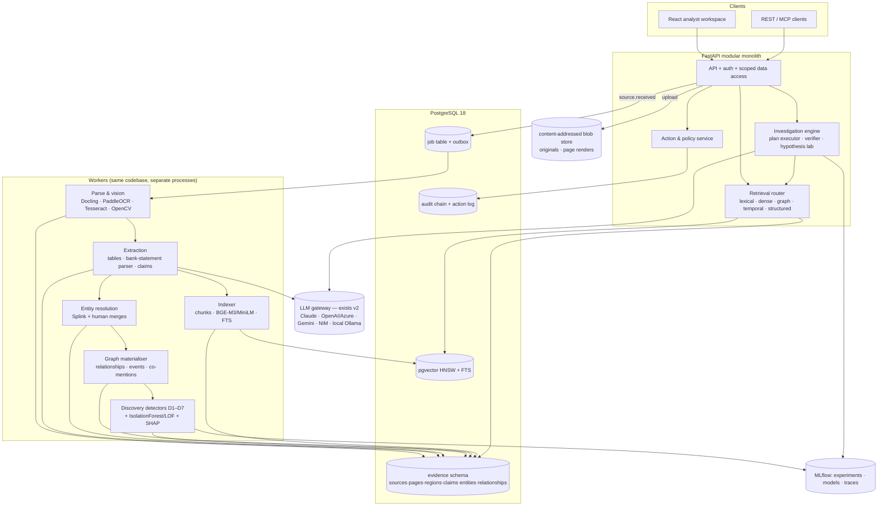

# MindDoc — Target System Architecture (Stage C, proposal v0.1)

> **Status: proposal for review. Nothing in this document is implemented unless marked "exists (v2)".**
> Inputs: current-state audit (`docs/audit/CURRENT_STATE_AUDIT.md`), technology evaluation
> (`docs/research/TECHNOLOGY_EVALUATION.md`), industry landscape (`docs/research/INDUSTRY_LANDSCAPE.md`), market
> selection (`docs/strategy/MARKET_SELECTION.md`), research gaps (`docs/research/RESEARCH_GAPS.md`).
> Companion specs: `DATA_MODEL.md`, `EVENT_CATALOG.md`, `INVESTIGATION_ENGINE.md`, `EVALUATION_FRAMEWORK.md`,
> `SECURITY_ARCHITECTURE.md`, decisions in `docs/adr/`.

## 0. What we are building, in one paragraph

An **evidence intelligence system for forensic review of borrower fund flows** (primary market; procure-to-pay
integrity as fallback). It converts a case file — bank statements, sanction letters, ledgers, invoices, GST returns,
stock statements, director data — into a **bitemporal, claim-centric evidence graph** whose every value is anchored to a
page region; runs **deterministic forensic detectors and calibrated ML** over it; lets an analyst **investigate,
challenge and approve** findings through an evidence-constrained agent; and exports a **report in which every sentence
resolves to pixels**. The product is the evidence graph, the detectors and the review workflow — not the chatbot.

## 1. Architectural stance

| Principle | Consequence |
|---|---|
| Modular monolith + workers ([ADR-0001](../adr/0001-modular-monolith.md)) | one FastAPI codebase, one Postgres; workers are processes of the same code. No microservices until a module needs independent scaling. |
| One transactional home ([ADR-0002](../adr/0002-postgres-system-of-record.md)) | PostgreSQL 18: evidence, vectors (pgvector), full-text, job queue, outbox, audit. Fewer consistency problems than 4 stores. |
| Claims, not facts ([ADR-0004](../adr/0004-claim-centric-bitemporal-model.md)) | epistemic status and bitemporality are in the schema, not in prompts. |
| Deterministic first, ML second, LLM last ([ADR-0007](../adr/0007-own-plan-executor.md)) | numbers come from tools; LLMs plan, extract, verify and write. |
| Events defined now, Kafka at a trigger ([ADR-0003](../adr/0003-job-table-outbox-then-kafka.md)) | same contracts on a Postgres outbox today, Kafka when fan-out + replay are real. |
| Licence-clean by default ([ADR-0006](../adr/0006-document-parsing-stack.md)) | the MVP ships on customer machines, so no AGPL/NC model or GPL library in the default build. |
| Measured, not claimed | every layer has an eval suite; the UI shows only numbers a benchmark run produced. |

## 2. System diagram



## 3. Layers

Each layer card: **purpose · responsibilities · in/out · internals & algorithms · technology (now / defer) · API &
events · failure handling · security · evaluation · priority & dependencies · why it is hard (interview value)**.

---

### L1 — Acquisition & ingestion
- **Purpose:** accept heterogeneous case files reliably and make their processing state visible.
- **Responsibilities:** upload (single, bulk zip, folder), content sniffing, dedup by SHA-256, per-tenant quotas,
  lifecycle tracking, retries, dead-letter, reprocessing with new versions.
- **In → out:** files → `Source` rows + `source.received` events; lifecycle `received→…→analysed|failed(stage)`.
- **Internals:** upload streams to blob store (hash while streaming) → transaction writes `Source` + outbox event →
  dispatcher enqueues jobs → workers claim with `SELECT … FOR UPDATE SKIP LOCKED` → idempotent stage handlers.
- **Tech:** FastAPI streaming upload, Postgres job table + outbox (now); Kafka 4 KRaft (defer: 3+ independent consumer
  groups needing replay, or >~200 events/s — EVENT_CATALOG §1).
- **API/events:** `POST /sources` (multipart or presigned), `GET /sources/{id}/lifecycle`; `source.*`, `*.failed`.
- **Failures:** per-stage retry with backoff → DLQ view with retry/discard actions; poison-file isolation.
- **Security:** sandboxed parser process (CPU/mem/time limits), PDF JS/embedded-file stripping, bomb guards.
- **Eval:** throughput (docs/min, pages/min), p95 time-to-indexed, DLQ rate, duplicate detection precision.
- **Priority:** P0 · depends on L3 schema · **exists (v2):** synchronous in-request ingestion + SHA dedup.
- **Why hard:** idempotency across DB + blob + index without distributed transactions; fair scheduling.

### L2 — Multimodal document intelligence
- **Purpose:** turn pages into typed, located regions — text, tables (cells), figures, signatures/stamps — with confidence.
- **Responsibilities:** text-layer extraction; OCR for scanned pages; layout and reading order; table structure;
  bank-statement parsing with running-balance reconciliation; image quality/deskew; figure captions (VLM, flagged
  *ungrounded*); document classification.
- **In → out:** `Source` → `Page`, `Region`, `TableCell` (normalised bboxes) + quality metrics.
- **Internals:** Docling conversion (layout + TableFormer) → per-page decision text-layer vs OCR → PaddleOCR PP-OCRv5
  (Tesseract fallback) on preprocessed images (**keeps v2's OpenCV quality/deskew/CLAHE stage**) → table structure
  (TableFormer vs PP-StructureV3, chosen by TEDS on DocBench) → bank-statement row model: date/narration/debit/credit/
  balance column detection, row reconciliation `bal[i] = bal[i-1] + cr − dr`, page-level reconciliation flag.
- **Tech (now):** Docling, PaddleOCR, Tesseract, OpenCV, pypdfium2 (rendering/highlights). **Defer:** Granite-Docling
  VLM (if Docling fails >~10% of DocBench pages), local Qwen3-VL (GPU). **Reject:** PyMuPDF in the default build
  (AGPL-3.0 — audit), EasyOCR (stagnant, slow), LayoutLMv3 (NC), Ultralytics/DocLayout-YOLO (AGPL), Table Transformer
  (archived).
- **Events:** `document.parsed`, `page.ocr.completed`.
- **Failures:** low-quality page → `quality=poor` + OCR confidence → claims inherit `extraction_suspect`; never silent.
- **Eval:** CER/WER (OCR), TEDS (tables), grounding IoU hit-rate, % statement pages reconciling, s/page on CPU.
  DocBench-50: 50 hand-labelled pages of the target document types (synthetic + public, licence-clean).
- **Priority:** P0 · **exists (v2):** PyMuPDF text, OpenCV quality/layout heuristics, EasyOCR, PDF highlight.
- **Why hard:** reconciliation as a self-check turns OCR from "best effort" into *verifiable* extraction.

### L3 — Canonical evidence & provenance
- **Purpose:** the single source of truth connecting pixels to conclusions (`DATA_MODEL.md`).
- **Responsibilities:** sources/pages/regions, mentions, entities + identifiers, claims (with modality, valid time),
  evidence links, relationships (materialised from claims), events, contradictions, findings, reviews, audit chain.
- **Internals:** deterministic IDs; append-only decision tables; bitemporal columns; materialised `relationship` and
  `entity_summary` views; lineage API `GET /lineage/{object}` returning the chain to `Source.sha256`.
- **Tech:** PostgreSQL 18 (+ Row-Level Security), SQLAlchemy 2 + Alembic migrations.
- **Eval:** lineage completeness (100% of findings resolve to a region), referential integrity tests, migration tests.
- **Priority:** P0, first · **exists (v2):** documents/chunks/entities/relations (flat, no claims, no bitemporality).
- **Why hard:** modelling "who said what, when, and who checked it" without collapsing epistemic states.

### L4 — Retrieval & RAG
- **Purpose:** find the right evidence for a question with the cheapest sufficient strategy.
- **Internals:** router (rules → learned) selects among lexical (Postgres FTS/BM25), dense (pgvector HNSW, BGE-M3 or
  MiniLM by benchmark), contextual chunks (situating prefix), graph-local/path (L5), temporal (as-of filters),
  structured (SQL over claims/table cells for sums and counts), compare (two-document diff); fusion by RRF; rerank
  (MiniLM fast / bge-reranker-v2-m3 accurate); MMR; corrective step: if top evidence score < τ, reformulate once, then
  abstain. Answers cite claim/region IDs. v2's similarity-based claim verifier **fails on wrong numbers, swapped
  parties and negation** (audit) and its confidence is uncalibrated → replaced by consistency checks + NLI +
  recomputation + a calibrated score (backlog Phase 5).
- **Tech:** pgvector, Postgres FTS, sentence-transformers. **Defer:** Qdrant (>5–10M vectors).
- **Eval:** Recall@k, MRR, nDCG@10, citation P/R, unsupported-sentence rate, abstention P/R, p95 latency, tokens/query;
  ablations R1–R3 (`EVALUATION_FRAMEWORK.md`).
- **Priority:** P1 · **exists (v2):** in-memory BM25 + MiniLM + RRF + cross-encoder + MMR + HyDE + verifier.
- **Why hard:** routing is measurable (cost vs quality), and structured retrieval answers "how much" questions RAG can't.

### L5 — Temporal knowledge graph & ontology
- **Purpose:** the connected, time-aware model of the case — the main analyst surface.
- **Internals:** ontology packs (lender forensic; P2P) with predicate domain/range + cardinality; relationship
  materialisation from claims with status (`candidate→corroborated→verified`, `contested`); co-mentions kept separate;
  graph analytics on demand: shortest/k-paths, ego networks, Louvain/Leiden communities, PageRank/betweenness,
  bounded cycle search, time-sliced snapshots and graph diff by system time.
- **Tech:** Postgres adjacency + recursive CTEs; NetworkX + graspologic (BSD/MIT) in-process (ADR-0005).
  **Defer:** Apache AGE (ad-hoc Cypher), Neo4j (deep interactive traversals at 10M+ edges; note GPL/RBAC limits).
- **UI:** Cytoscape.js explorer — node/edge inspectors with evidence, expand/collapse, filters by type/status/time,
  path finder, time slider, diff overlay, subgraph export. Sigma.js at >~5k nodes.
- **Eval:** ER pairwise/B³ F1, triple P/R/F1, temporal-qualifier accuracy, false-merge rate, query p95.
- **Priority:** P0 (explorer) / P1 (analytics) · **exists (v2):** regex+LLM entities, co-occurrence edges, canvas graph.
- **Why hard:** correct identity resolution and honest edge semantics are what make graph analytics meaningful.

### L6 — ML discovery & anomaly intelligence
- **Purpose:** surface leads nobody asked for, with calibrated, explainable scores.
- **Internals:** detector plugins D1–D7 (`INVESTIGATION_ENGINE.md §5`) + generic statistics (Benford, threshold
  avoidance) + IsolationForest/LOF on engineered transaction features (amount z-scores per counterparty, timing,
  graph features such as degree/PageRank/shared-identifier counts) with SHAP attributions; Discovery Ledger with
  dispositions; supervised re-ranker (LightGBM) trained on dispositions **only after** it beats rules on held-out data;
  calibration (isotonic/Platt) before any score is displayed as a probability.
- **Tech:** scikit-learn, LightGBM, SHAP, MLflow (runs, registry), Optuna; DVC deferred (>~1 GB artefacts).
- **Eval:** recall of injected schemes, Precision@k, false alarms per case, PR-AUC, ECE (MindDoc-Synth benign look-alikes).
- **Priority:** P1 · **exists (v2):** topic clustering, zero-shot doc classification only.
- **Why hard:** honest evaluation of unsupervised detection needs the seeded synthetic benchmark with benign look-alikes.

### L7 — Evidence-constrained investigation (GenAI + agents)
- **Purpose:** answer investigation questions and draft findings that survive scrutiny.
- **Internals:** `INVESTIGATION_ENGINE.md` — Planner → typed plan DAG (shown and editable) → tool execution with
  permission checks → Verifier (completeness, entailment, recomputation, counter-evidence, leave-one-source-out
  fragility) → Writer → human approval. Durable `investigation_step` state machine in Postgres; budgets; traces.
- **Tech:** own plan executor over the existing LLM gateway (ADR-0007); structured outputs (Pydantic); OpenTelemetry
  GenAI spans. **Defer:** Temporal (multi-day investigations with timers). **Reject:** NeMo Agent Toolkit (deprecated).
- **Eval:** task success on scripted investigations, tool-selection accuracy, unsupported-claim rate, fragile-finding
  detection, cost & latency per investigation; ablation A1 (with/without verifier).
- **Priority:** P1 (after L3–L6 produce trustworthy tools) · **exists (v2):** single-pass RAG with plan/HyDE/judge.
- **Why hard:** making an agent's output *auditable and reproducible* — research direction E lives here.

### L8 — Continuous discovery
- **Purpose:** when new evidence arrives, update conclusions and say what changed.
- **Internals:** `graph.updated`/`document.extracted` trigger incremental detectors; affected findings are re-verified;
  graph diff and "finding changed because of source X" notifications; evidence-acquisition suggestions for
  undetermined hypotheses (research direction D — experimental, labelled as such).
- **Tech:** outbox events → (later) Kafka consumer group `discovery`.
- **Eval:** time from upload to updated findings; correctness of change attribution on synthetic incremental cases.
- **Priority:** P2.

### L9 — Investigation & decision workspace (UI)
- **Purpose:** make the engineering usable and demonstrable.
- **Workspaces (MVP):** Case overview (ingestion status, findings register), Evidence viewer (page + highlights + OCR
  layer), Graph explorer, Fund-flow view, Timeline, Review queue, Report builder, System/eval. Later: Hypothesis Lab,
  Agent Control Room, Model Lab. Graph, timeline and document views share a selection context.
- **Priority:** P0 for viewer/graph/register; P1 for the rest · **exists (v2):** 8 pages incl. graph, timeline, vision.

### L10 — Security & governance
`SECURITY_ARCHITECTURE.md`: RBAC + markings enforced in the data layer (+ Postgres RLS), agents act as the requesting
principal, tool side-effect classes with approval, hash-chained audit, PII markings + optional redaction before external
LLM calls, local-model mode, retention/deletion cascade, sandboxed parsing. **P0 for isolation and audit**, P1 for RBAC.

### L11 — Infrastructure, observability & MLOps
- **Deployment evolution:** (1) single-tenant Docker Compose on a firm machine — API, worker, Postgres, optional
  Ollama; (2) India-region cloud single-tenant per customer; (3) multi-tenant SaaS with RLS, per-tenant keys, Kafka,
  object storage, horizontal workers. Kubernetes only at (3).
- **Observability:** OpenTelemetry traces (API, workers, LLM calls with GenAI conventions) → MLflow tracing / Jaeger;
  metrics endpoint; cost per document/investigation from token + CPU accounting.
- **MLOps:** MLflow experiments + model registry; prompt templates versioned in repo with hashes; eval gates in CI.
- **CI/CD:** lint, type-check, unit + integration (Postgres in CI), smoke eval, frontend build, container build.

## 4. Data flow: one borrower case end to end

```
upload 300 files ─► L1 lifecycle ─► L2 pages/regions/tables (+ reconciliation flags)
  ─► L3 claims (transactions, invoices, GST periods, director links) ─► L5 entity resolution + graph
  ─► L6 detectors D1–D7 + anomaly scores ─► Discovery Ledger
  ─► analyst opens findings ─► L7 verify / investigate / hypothesis checks ─► review queue (approve/reject)
  ─► report with evidence bundle ─► audit chain
```

## 5. What one engineer can build vs. what needs more

| Can build alone (this plan) | Needs a team / infra later |
|---|---|
| everything in L1–L7, L9 on a single machine; Docker Compose deploy; synthetic benchmark; eval harness | SOC 2-style controls, SSO/SCIM, 24×7 ops, multi-region; GPU serving at scale; real customer data pipelines and legal review (DPDP processor terms); Indic-language OCR at production quality |
| simulate scale with generated cases (10k docs) to measure throughput | claim production readiness — only after a pilot on real (customer-controlled) data |
