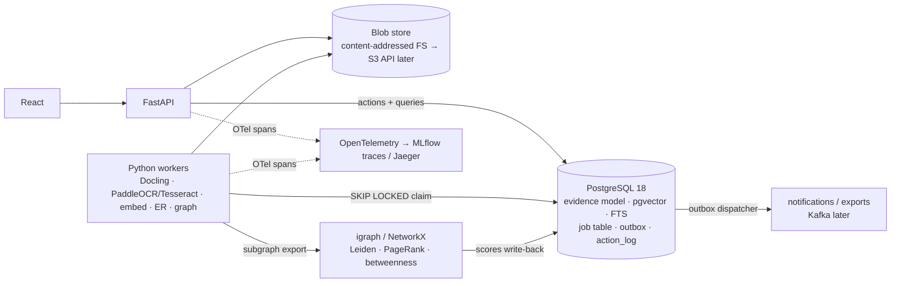

# MindDoc AI: Technology Evaluation

*Research date: 2026-11-10. Companion to [INDUSTRY_LANDSCAPE.md](./INDUSTRY_LANDSCAPE.md). This document covers candidate technologies for the "Evidence Intelligence" redesign: what each one does, how it works, its licence, whether it runs on CPU, a verdict (now / later with a trigger / no), a minimal sketch, and how to benchmark it.*

---

## 0. Ground rules

### 0.1 Verification legend

Same legend as INDUSTRY_LANDSCAPE.md:

| Tag | Meaning |
|---|---|
| **[V]** | Verified on a primary page fetched during this research |
| **[P]** | Primary source seen only as an excerpt or partial fetch |
| **[S]** | Secondary source |
| **[K]** | Author's prior knowledge, not re-checked this session |
| **[U]** | Unverified |

The web-search quota ran out near the end of the research, so some licence and version facts for well-known projects are tagged **[K]**. Check those in the project's LICENSE file before you ship anything.

> **Not legal advice.** The licence notes describe what the published terms say and what typically triggers obligations. GPL obligations generally attach on *distribution*. AGPL obligations also attach when users interact with the software *over a network*. Non-commercial licences (CC BY-NC, research licences) forbid commercial use outright. If MindDoc may become a product, treat every red flag below as blocking until a lawyer says otherwise.

### 0.2 Scale envelope the verdicts assume

Every "now / later" verdict assumes this envelope. A trigger condition means the envelope has been exceeded.

- **Hardware:** a single developer machine. CPU only, about 8–16 cores and 16–32 GB RAM, running Windows 11 (the owner's environment).
- **Corpus:** up to about 100k pages, about 1–5M chunks, about 1M entity mentions and about 10M relationship rows.
- **Users and load:** a handful of concurrent users, with ingestion arriving in bursts rather than continuously.
- **Current stack:** FastAPI, SQLite, an in-memory NumPy index, MiniLM plus a cross-encoder, OpenCV/EasyOCR/PyMuPDF, and React.

### 0.3 Recommended target shape (the "boring core")



**Why PostgreSQL is the first move (replacing SQLite):**

- One transactional store covers evidence rows, vectors, full-text search, the job queue, the outbox and the audit log, so commits are atomic across all of them.
- `FOR UPDATE SKIP LOCKED` is available for multi-worker queues [V].
- pgvector provides HNSW indexes with iterative filtered scans [V].
- Recursive CTEs handle graph hops.

SQLite has a single writer and offers no `SKIP LOCKED` or pgvector, so it can't serve all of these roles [K]. Keep SQLite for unit tests if you like.

---

## 1. Messaging, CDC and orchestration

### 1.1 Apache Kafka

- **What it does:** a distributed, partitioned, replicated append-only log. Producers write to topic partitions, and consumers in a **consumer group** split the partitions among themselves and commit offsets. Ordering holds only *within* a partition, and a group's parallelism is capped at the partition count [K, established].
- **KRaft:**
  - Kafka **4.0 (18 Mar 2025)** was the first release without ZooKeeper. ZooKeeper-mode clusters must migrate to KRaft before upgrading [P].
  - The current release is **4.4.0 (22 Oct 2026)**, and 4.3.2 (23 Oct 2026) fixed two potential tiered-storage data-loss issues [V]. *Changed recently.*
- **Queues for Kafka (share groups, KIP-932):** per-message acknowledgement semantics instead of partition ownership. Status by release: early access in 4.0, preview in 4.1, and **production-ready in 4.2** (Feb 2026) [P]. One secondary source notes there is no built-in dead-letter queue [S]. *Changed recently.*
- **Exactly-once semantics (EOS) and its limits:**
  - The idempotent producer "guarantees that resending will not result in duplicate entries in the log". Transactions write atomically across partitions. Kafka Streams supports exactly-once [V].
  - The key limit, from the official docs: **"Exactly-once delivery for other destination systems generally requires cooperation with such systems."** [V]
  - In practice, a consumer that writes to PostgreSQL is **at-least-once** and must be idempotent (upserts keyed by event ID).
  - `read_committed` consumers can stall behind open transactions, and transactions cost throughput [S].
- **Problem it solves:** durable fan-out of one event stream to many independent consumers, replay from any offset, and high throughput.
- **Where it's used:** event-driven microservices, CDC pipelines, and stream processing feeds [K].
- **Limitations for MindDoc:**
  - It is a separate distributed system to operate: brokers, controllers, monitoring and retention.
  - It becomes a second source of truth next to the database.
  - At MindDoc's volume (bursty, at most hundreds of jobs per minute) it adds latency and complexity without any capacity benefit.
- **Alternatives:** a Postgres queue (§1.6), Redis Streams (§1.5), Redpanda (§1.4), NATS JetStream [K, not evaluated].
- **Licence:** Apache-2.0 [K].
- **CPU feasibility:** yes. A single-node KRaft broker runs in Docker, but expect about 1 GB or more of RAM [K].
- **Verdict: LATER.** Adopt it when any of these holds:
  - (a) three or more independently deployed services need the same event stream with replay,
  - (b) sustained event rates exceed about 200/s, or the Postgres queue shows lock or poll contention in benchmarks,
  - (c) an external system you must integrate with speaks Kafka.
- **Minimal sketch (for later):**
  ```text
  topic evidence.document.v1   key=document_id  (all events for a document stay ordered)
  topic evidence.finding.v1    key=investigation_id
  consumer: on event → BEGIN; INSERT INTO processed_event(event_id) ON CONFLICT DO NOTHING;
            if inserted → apply effect; COMMIT; then commit offset   (idempotent sink)
  ```
- **Benchmark:**
  - Throughput and p50/p99 end-to-end latency with `kafka-producer-perf-test` / `kafka-consumer-perf-test` on the laptop.
  - A chaos test: `kill -9` a consumer mid-batch and count duplicate effects (target: 0 thanks to the idempotent sink).

### 1.2 Transactional outbox and Debezium CDC

- **What it does:**
  - **Outbox:** write the business change *and* an `outbox` row in the same database transaction. A separate process then publishes the outbox rows.
  - **Debezium:** reads the Postgres WAL (logical decoding) and turns committed outbox inserts into Kafka messages.
- **Debezium 3.7 Outbox Event Router (stable docs)** [V]:
  - **Expected columns:** `id` (UUID, sent as a header), `aggregatetype` (drives the topic name), `aggregateid` (message key, which keeps per-aggregate ordering), `type`, and `payload` (jsonb).
  - **Default topic:** `outbox.event.<aggregatetype>`.
  - **Inserts only:** the outbox works as a queue. UPDATEs trigger `table.op.invalid.behavior` (default `warn`), and DELETEs are filtered out.
- **Problem it solves:** the dual-write problem (the DB commit succeeds but the publish fails, or the reverse).
- **Limitations:**
  - Debezium needs Kafka Connect and `wal_level=logical` [K].
  - Outbox rows need a cleanup job, since the docs give no purge guidance [V].
- **Licence:** Debezium is Apache-2.0 [K].
- **CPU feasibility:** yes.
- **Verdict:**
  - **Outbox table: NOW.** It is cheap and is the right shape for approvals that trigger exports or notifications.
  - **Debezium: LATER**, together with Kafka.
- **Sketch:**
  ```sql
  CREATE TABLE outbox (
    id uuid PRIMARY KEY, aggregatetype text NOT NULL, aggregateid text NOT NULL,
    type text NOT NULL, payload jsonb NOT NULL,
    created_at timestamptz NOT NULL DEFAULT now(), dispatched_at timestamptz);
  -- inside the action transaction:
  -- UPDATE finding SET status='approved' ...; INSERT INTO action_log ...;
  -- INSERT INTO outbox VALUES (gen_random_uuid(),'finding',$id,'FindingApproved',$json);
  -- dispatcher: SELECT ... WHERE dispatched_at IS NULL ORDER BY created_at FOR UPDATE SKIP LOCKED LIMIT 100
  ```
  The column names match Debezium's defaults, so moving to CDC later needs no schema change.
- **Benchmark:**
  - Inject failures between the commit and the dispatch, and assert that every committed action produces exactly one dispatched effect, using an idempotent receiver.

### 1.3 Schema registry

- **What it does:** a central registry of event schemas (Avro, Protobuf, JSON Schema) that enforces compatibility rules on producers and consumers.
- **Licence red flag:** **Confluent Schema Registry** is licensed under the **Confluent Community License**, with only the client, serde and Avro modules under Apache-2.0 [V]. That licence is source-available, not OSI open source.
- **Alternatives:** Apicurio Registry and Karapace (both Apache-2.0) [K, not evaluated in depth].
- **Verdict:**
  - **NOW:** keep versioned Pydantic event models plus exported JSON Schema files in the repo. Every event carries a `schema_version`.
  - **Registry LATER:** add one with Kafka once more than one team or service produces events.

### 1.4 Redpanda

- **What it does:** a Kafka-API-compatible broker written in C++, with no JVM and no ZooKeeper [K].
- **Licence red flag:**
  - The Community Edition is under the **Redpanda Business Source License (BSL)**, which is source-available.
  - Older docs say you may not offer it as a commercial streaming or queuing service, and that BSL code converts to Apache-2.0 four years after each merge.
  - Enterprise features (tiered storage and others) sit under the Redpanda Community License and need a licence key [P].
- **Verdict: NO.** MindDoc doesn't need a Kafka API yet. If it does later, Apache Kafka on KRaft avoids the licence question. Using Redpanda's dev container for local experiments is fine.

### 1.5 Redis Streams

- **What it does:** an append-only stream type with consumer groups [K]:
  - `XADD` appends entries.
  - `XREADGROUP` reads, and delivered entries go into a pending-entries list until `XACK`.
  - `XAUTOCLAIM` reclaims entries from consumers that died.
  - Delivery is at-least-once.
- **Recent additions:** the docs list consumer-group-aware deletion and trimming in **Redis 8.2** and idempotent production in **Redis 8.6** [V, command table]. *Changed recently.*
- **Persistence:** AOF and RDB with asynchronous replication, so recent writes can be lost on crash or failover depending on fsync settings [K].
- **Licence:**
  - **Redis 8+** is under your choice of RSALv2, SSPLv1 or **AGPLv3**.
  - 7.4–7.8 are RSALv2/SSPLv1 only, and 7.2 and earlier are BSD [P].
  - Valkey is a BSD-licensed fork [K].
- **Verdict: NO.** It would add a second stateful system with weaker default durability and no transactional coupling to evidence writes. Reconsider Redis or Valkey only as a cache.

### 1.6 Postgres-backed queues (job table with `SKIP LOCKED`, or pgmq)

- **What it does:** workers claim rows with `SELECT ... FOR UPDATE SKIP LOCKED`. The PostgreSQL docs say this "can be used to avoid lock contention with multiple consumers accessing a queue-like table" and also warn it "is not suitable for general purpose work" because it gives an inconsistent view of the data [V, PG 18.6 docs].
- **pgmq:**
  - An SQS-like API with a visibility timeout set at read time. A message that is neither deleted nor archived before the timeout becomes visible again.
  - It runs as an extension or as plain SQL.
  - It uses the PostgreSQL licence [S/P].
- **Problem it solves:** durable background jobs that commit atomically with evidence writes, with no extra infrastructure.
- **Limitations:**
  - Polling load.
  - Table bloat from dead tuples, which needs autovacuum tuning and partitioning or archiving [K].
  - No fan-out or replay semantics (that is Kafka's job).
- **Licence:** PostgreSQL licence (Postgres and pgmq) [K/S].
- **CPU feasibility:** yes.
- **Verdict: NOW.** Use a hand-rolled job table, which is simplest on Windows, or pgmq if the extension is available.
- **Sketch:**
  ```sql
  CREATE TABLE job (
    id bigserial PRIMARY KEY, kind text NOT NULL, payload jsonb NOT NULL,
    idempotency_key text UNIQUE,                 -- e.g. sha256(doc)||':ocr:'||extractor_version
    status text NOT NULL DEFAULT 'queued',       -- queued|running|done|failed|dead
    attempts int NOT NULL DEFAULT 0, max_attempts int NOT NULL DEFAULT 5,
    run_after timestamptz NOT NULL DEFAULT now(),
    locked_by text, locked_until timestamptz, last_error text,
    created_at timestamptz NOT NULL DEFAULT now());
  CREATE INDEX job_ready ON job (kind, run_after) WHERE status = 'queued';

  -- claim one job (lease = visibility timeout)
  WITH next AS (
    SELECT id FROM job
    WHERE status='queued' AND run_after <= now() AND kind = ANY($1)
    ORDER BY run_after FOR UPDATE SKIP LOCKED LIMIT 1)
  UPDATE job j SET status='running', attempts=attempts+1, locked_by=$2,
                   locked_until=now()+interval '5 minutes'
  FROM next WHERE j.id=next.id RETURNING j.*;
  -- reaper: UPDATE job SET status='queued', run_after=now()+backoff(attempts)
  --         WHERE status='running' AND locked_until < now();
  ```
- **Benchmark:**
  - Run N workers (1, 4, 8, 16) against 100k no-op jobs and measure jobs/s and p95 claim latency.
  - Kill workers at random and assert no job is lost and duplicates only occur after a lease expires.
  - Watch `n_dead_tup` and table size over time.

### 1.7 Temporal vs a durable job table

- **What it does:**
  - **Durable execution.** Workflow code must be deterministic and is *replayed* from an event history. Side effects run in activities with retries.
  - **History limits** [P]: a hard cap of **51,200 events / 50 MB per execution** (warnings from about 10,000), a **2 MB payload** limit, and Continue-As-New to reset history.
  - **Server and tooling** [V]: the server is **MIT**, and `temporal server start-dev` runs a local dev server with a web UI on port 8233.
  - **SDKs:** a Python SDK exists [P].
- **What it gives over a job table [K]:** durable timers, signals (useful for "wait for human approval"), workflow versioning, a visibility UI, and retry policies written as code.
- **What it costs:**
  - A cluster with its own database.
  - Determinism constraints, so no `datetime.now()` or random calls inside workflows.
  - A real learning curve.
  - Payload limits, so large documents must stay in the blob store.
- **Verdict: LATER.** Adopt it when investigations become long-running (days), multi-step processes with timers, escalations or signals across several worker types, *and* the hand-rolled state machine needs versioned migration of in-flight runs.
- **Use now instead:** an explicit state machine in Postgres.
  ```sql
  CREATE TABLE investigation_step (
    investigation_id bigint, step_no int, kind text,          -- 'retrieve','hypothesize','await_approval'
    status text, input jsonb, output jsonb, idempotency_key text UNIQUE,
    created_at timestamptz DEFAULT now(), PRIMARY KEY (investigation_id, step_no));
  ```
  An agent run that pauses for approval writes `status='await_approval'`. The approval *action* resumes it. This mirrors the OpenAI and LangGraph pause, serialize and resume model (INDUSTRY_LANDSCAPE §5.1).
- **Benchmark (if adopted):**
  - Run 1,000 workflows with three activities each and a human-signal wait, and record completion, p95 step latency, and resource use of the dev server.

### 1.8 Apache Flink

- **What it does:** stateful stream processing with event time, watermarks and windows. Exactly-once *state* comes from distributed checkpoints. It runs on the JVM, and PyFlink is available [K].
- **Licence:** Apache-2.0 [K].
- **Verdict: NO** for the foreseeable horizon. It would only become relevant for continuous, high-rate (more than about 10k events/s) event-time aggregations over live feeds, which is not MindDoc's workload.

### 1.9 Apache Spark

- **What it does:** distributed DataFrame batch and streaming processing on the JVM. Licence is Apache-2.0 [K].
- **Single-node alternatives:** DuckDB and Polars [K]. Splink already runs on DuckDB (§6).
- **Verdict: NO now, LATER** if either of these holds:
  - working sets exceed what DuckDB handles on one machine (hundreds of GB),
  - entity resolution reaches 100M+ records (Splink supports Spark [V]).

### 1.10 Messaging summary

| Option | Delivery semantics | Transactional with evidence writes | Ops weight | Licence | MindDoc |
|---|---|---|---|---|---|
| Postgres job table / pgmq | At-least-once, lease-based | **Yes** | None extra | PostgreSQL | **Now** |
| Outbox table (+ in-process dispatcher) | At-least-once | **Yes** | None extra | n/a | **Now** |
| Kafka (KRaft) + Debezium | At-least-once to external sinks, EOS Kafka-to-Kafka | Via outbox/CDC | High | Apache-2.0 | Later |
| Temporal | Durable execution (replay) | Via activities | Medium-high | MIT | Later |
| Redis Streams | At-least-once | No | Medium | RSAL/SSPL/AGPL (8+) | No |
| Redpanda | Kafka-compatible | Via outbox/CDC | Medium | BSL + RCL | No |

---

## 2. Storage and retrieval

### 2.1 PostgreSQL and pgvector (HNSW)

- **What it does:** adds vector types and approximate-nearest-neighbour indexes inside Postgres. Indexes are IVFFlat or **HNSW**, a layered proximity graph searched greedily from the top layer down [K].
- **Facts** [V, README, latest **v0.8.7**]:
  - **HNSW defaults:** `m=16`, `ef_construction=64`, `hnsw.ef_search=40`.
  - **Max indexed dimensions:** `vector` 2,000, `halfvec` 4,000, `bit` 64,000.
  - **Iterative index scans (since 0.8.0):** set `hnsw.iterative_scan` to `strict_order` or `relaxed_order`, with `hnsw.max_scan_tuples` defaulting to 20,000. This fixes "overfiltering", where approximate indexes apply filters *after* the scan.
  - **Filtering guidance:** use B-tree indexes on filter columns, partial indexes for a few distinct values, partitioning for many, and iterative scans when filters match a large share of rows.
  - **Hybrid search:** Postgres full-text search plus vectors, merged with **RRF** or a cross-encoder.
- **Problem it solves:** vectors live next to evidence rows, so you get joins and filters by workspace, marking or time in the same query, one backup, and transactional consistency.
- **Limitations:**
  - HNSW build is memory-hungry (`maintenance_work_mem`) and slow at multi-million scale [K].
  - Single-node only.
  - Recall depends on tuning `ef_search`.
  - Only post-filter semantics, unless you use iterative scans or partitioning.
- **Alternatives:** Qdrant, Weaviate, OpenSearch (below), or the current NumPy brute-force index (fine up to roughly 10^5 vectors [K]).
- **Licence:** PostgreSQL licence [K].
- **CPU feasibility:** yes.
- **Verdict: NOW.**
- **Sketch:**
  ```sql
  CREATE EXTENSION IF NOT EXISTS vector;
  CREATE TABLE chunk (
    id bigserial PRIMARY KEY, region_id bigint NOT NULL, workspace_id int NOT NULL,
    text text NOT NULL, context text,                       -- "Title > Section > p.4"
    tsv tsvector GENERATED ALWAYS AS (to_tsvector('english', coalesce(context,'')||' '||text)) STORED,
    embedding halfvec(1024), embed_model text NOT NULL);
  CREATE INDEX chunk_hnsw ON chunk USING hnsw (embedding halfvec_cosine_ops) WITH (m=16, ef_construction=64);
  CREATE INDEX chunk_tsv  ON chunk USING gin (tsv);
  CREATE INDEX chunk_ws   ON chunk (workspace_id);

  SET hnsw.ef_search = 100; SET hnsw.iterative_scan = relaxed_order;
  WITH dense AS (
    SELECT id, row_number() OVER (ORDER BY embedding <=> $1) r FROM chunk
    WHERE workspace_id=$2 ORDER BY embedding <=> $1 LIMIT 50),
  sparse AS (
    SELECT id, row_number() OVER (ORDER BY ts_rank_cd(tsv, q) DESC) r
    FROM chunk, plainto_tsquery('english', $3) q
    WHERE workspace_id=$2 AND tsv @@ q ORDER BY ts_rank_cd(tsv, q) DESC LIMIT 50)
  SELECT id, sum(1.0/(60+r)) AS rrf FROM (SELECT * FROM dense UNION ALL SELECT * FROM sparse) u
  GROUP BY id ORDER BY rrf DESC LIMIT 30;   -- then cross-encoder rerank in Python
  ```
- **Benchmark:**
  - **Recall@10 vs exact search:** run the same query with the index disabled (`SET enable_indexscan=off`) for 1,000 sampled queries.
  - **Latency and footprint:** p50/p95 latency at 100k, 1M and 5M chunks, with filter selectivity of 1%, 10% and 50% (iterative scan on and off), plus index build time and size.
  - **Sweep:** `ef_search` across {40, 100, 200}.

### 2.2 Qdrant

- **What it does:** a dedicated vector database written in Rust [V]:
  - payload filtering with must, should and must_not clauses,
  - dense plus **sparse** vectors with hybrid queries fused by **RRF/DBSF**,
  - built-in quantization ("cuts RAM usage by up to 97%"),
  - **Qdrant Edge**, an in-process embedded mode for Python and Rust.
  - HNSW with filter-aware search [K].
- **Licence:** Apache-2.0 [V].
- **CPU feasibility:** yes.
- **Limitations:**
  - A second datastore, so consistency with Postgres needs the outbox.
  - Vector rows are no longer transactional with evidence rows.
- **Verdict: LATER.** Adopt it when either holds:
  - more than about 5–10M vectors, or filtered p95 latency above target (for example 200 ms) after tuning pgvector,
  - you need multi-vector / late-interaction retrieval (for example BGE-M3 ColBERT vectors).
- **Benchmark:** the same harness as §2.1, so the comparison is like-for-like.

### 2.3 Weaviate

- **What it does:** a vector database with built-in BM25-plus-vector hybrid search. The README's Docker example uses v1.36.0 [V].
- **Licence nuance (changed recently):**
  - "Most of this repository is available under the BSD 3-Clause License".
  - The `wl/` folder is under a separate commercial licence, and "Enterprise features require a license key" [V].
- **Verdict: NO.** Qdrant is the cleaner "later" option for MindDoc.

### 2.4 OpenSearch

- **What it does:** a Lucene-based search engine with BM25, analyzers, highlighting, aggregations and k-NN vector search. It runs on the JVM [K].
- **Licence:** Apache-2.0 [K].
- **Verdict: NO now, LATER** if full-text needs outgrow Postgres FTS: multilingual analyzers, large-scale highlighting, faceted aggregations, or more than about 10M chunks.

### 2.5 Object storage (MinIO / S3)

- **MinIO: changed recently, red flag** [V]:
  - The licence is **AGPLv3**.
  - The GitHub repository **"was archived by the owner on Apr 25, 2026"** and the README says "THIS REPOSITORY IS NO LONGER MAINTAINED".
  - The community edition is "distributed as source code only", with no new binaries, and users are pointed to AIStor (Free or Enterprise).
- **Verdict:**
  - **MinIO: NO.**
  - **NOW:** a content-addressed local blob store behind a small `BlobStore` interface.
  - **LATER:** an S3-API implementation using boto3 against AWS S3 or a compatible service, adopted on multi-host deployment or when local disk runs out. Self-hosted S3-compatible options such as SeaweedFS, Garage and Ceph RGW exist [K, not evaluated, licences not checked].
- **Sketch:**
  ```text
  blobs/ab/cd/<sha256>                         -- immutable original
  derived/<sha256>/page-0004@pymupdf-1.24@150dpi.png
  blob(sha256 PK, size, mime, created_at); document.blob_sha256 FK
  ```
- **Benchmark:**
  - Ingest 1,000 files and verify that re-ingest deduplicates by hash.
  - Measure page-render cache hit rate.

---

## 3. Graph storage and algorithms

### 3.1 Neo4j

- **What it does:** a native property-graph database queried with Cypher [K].
- **Licence and editions (Operations Manual 2026.10)** [V]:
  - Community Edition is "Open source under **GPLv3**" and single-instance.
  - **Enterprise Edition** adds clustering, **role-based access control and LDAP**, and online backup.
- **Graph Data Science (GDS):**
  - The Community GDS licence caps concurrency at **4 cores** [P].
  - Older docs cap the model catalog at 3 models [P].
  - GDS is reportedly GPLv3 [S].
- **Problem it solves:** fast multi-hop and pattern queries, plus a library of graph algorithms.
- **Limitations for MindDoc:**
  - A second database means dual writes, so you'd need outbox-driven sync.
  - RBAC (needed for markings) is Enterprise-only.
  - It's a JVM service.
- **Verdict: LATER (possibly never).** Adopt it only if interactive variable-length path queries (three or more hops) over more than about 10M edges miss their p95 target in Postgres, *and* analysts need ad-hoc Cypher.

### 3.2 Apache AGE

- **What it does:** a Postgres extension that adds openCypher queries over graphs stored in Postgres [K].
- **Recent releases:**
  - EDB release notes list **1.8.0 (11 Aug 2026)** for PG 18 and 1.7.0.1 (Mar 2026) for PG 17/18 [S].
  - Azure Database for PostgreSQL announced AGE as GA (May 2026) [S].
- **Limitations:**
  - Only an openCypher subset.
  - No built-in graph algorithm library (no PageRank or Leiden) [K].
  - Extension builds on Windows are awkward [K].
- **Licence:** Apache-2.0 [K].
- **Verdict: LATER**, and preferred over Neo4j if Cypher becomes valuable because it keeps one database and one transaction scope. Trigger: analysts need ad-hoc pattern queries that are painful to write as recursive CTEs.

### 3.3 Postgres adjacency plus NetworkX / igraph / graspologic (recommended)

- **What it does:** entities and relationships stay as rows. Traversals use recursive CTEs. For analytics, a **subgraph** is exported into an in-memory library, which computes Leiden communities, PageRank and betweenness, and the scores are written back as columns.
- **Libraries:**
  - **python-igraph:** C core, fast. Latest **1.0.0 (23 Oct 2025)**. Licence **GPL** [V] (GPL-2.0-or-later [K]).
  - **leidenalg:** GPL-3.0-or-later [S].
  - **NetworkX:** pure Python, BSD-3 [K]. `leiden_communities` was **backend-only in 3.5**, meaning it raises without a backend such as nx-cugraph [V]. The current development docs (3.7.1rc0.dev0) show a **native implementation** [V], so check your installed version. *Changed recently.*
  - **graspologic:** **MIT**, provides `hierarchical_leiden` (used by Microsoft GraphRAG). Latest 3.4.4 (Sep 2025), and it **requires Python < 3.13** [V].
- **Complexity:** exact betweenness is O(V·E) via Brandes. Use k-sample approximation above about 50k nodes [K].
- **Problem it solves:** graph analytics without a graph database. The subject-centred subgraphs used in investigations are small (10^3–10^5 nodes).
- **Licence implication:** igraph and leidenalg are GPL. Server-side use without distribution generally doesn't trigger GPL obligations. **Distributing** MindDoc (for example a desktop bundle) together with igraph could. A copyleft-free path is NetworkX (BSD) plus graspologic (MIT, Python ≤ 3.12).
- **CPU feasibility:** yes.
- **Verdict: NOW.**
- **Sketch:**
  ```sql
  -- 2-hop neighbourhood (edges stored once; view makes them undirected)
  CREATE VIEW edge_u AS SELECT src a, dst b, weight FROM relationship WHERE superseded_at IS NULL
                        UNION ALL SELECT dst, src, weight FROM relationship WHERE superseded_at IS NULL;
  WITH RECURSIVE hop(node, depth) AS (
    SELECT $1::bigint, 0
    UNION SELECT e.b, h.depth+1 FROM hop h JOIN edge_u e ON e.a=h.node WHERE h.depth < 2)
  SELECT DISTINCT node FROM hop;
  ```
  ```python
  import igraph as ig
  g = ig.Graph.TupleList(edges, directed=False, weights=True)   # edges: (src, dst, weight)
  comm = g.community_leiden(objective_function="modularity", weights="weight", n_iterations=-1)
  pr = g.pagerank(weights="weight")
  bt = g.betweenness(cutoff=None)          # use NetworkX betweenness_centrality(G, k=500) for big graphs
  ```
- **Benchmark:**
  - Synthetic graphs at 10k/100k nodes with 100k/1M edges: Leiden runtime and modularity across 5 seeds (stability via NMI between runs), PageRank runtime, and exact vs k-sample betweenness (Spearman ρ on the top-100).
  - Recursive CTE 2-hop p95 latency on the real `relationship` table.

---

## 4. Document understanding (OCR, layout, tables, VLMs)

### 4.0 How to benchmark every candidate in this section

Build a **MindDoc DocBench-50**: 50 pages stratified across these types:
- digital PDF,
- clean scan,
- noisy or skewed scan,
- phone photo,
- table-heavy,
- form,
- multi-column,
- any non-English language you care about.

Label each page with:
- text (score with CER/WER using `jiwer` [K]),
- tables as HTML (score with TEDS, the metric used by OmniDocBench and PubTabNet [K]),
- layout boxes (score with COCO mAP@0.5 via `pycocotools` [K]),
- reading order (score with Kendall τ).

Also record seconds per page and peak RSS on the target laptop, and the fraction of regions that carry a polygon plus span. That last number is the grounding coverage metric, and it matters most for an evidence platform.

Public sets for sanity checks: OmniDocBench (cited by PaddleOCR), DocLayNet, and PubTables-1M [V mentions].

### 4.1 Docling (IBM / LF AI & Data)

- **What it does and how:**
  - Converts PDF, Office, HTML, images, audio and email into a unified `DoclingDocument` with lossless JSON export [V].
  - The PDF pipeline runs a parser backend, then an **RT-DETR-based layout model** (11 labels, DocLayNet-referenced), **TableFormer** for table structure, optional OCR, and assembly [V].
  - Each item carries provenance: page number, bbox and char span [K, verify field names].
- **CPU numbers** (2024 technical report, OCR off, 225 pages) [V]:
  - **1.27–2.45 pages/s** on an M3 Max.
  - **0.60–1.57 pages/s** on a Xeon E5-2690.
  - The layout model has "sub-second latency" on one CPU.
  - TableFormer takes **2–6 s per table**.
  - EasyOCR "runs fairly slow on CPU (upwards of 30 seconds per page)".
- **Licence:**
  - Code is **MIT** [V].
  - The `docling-models` card is tagged **CDLA-Permissive-2.0 and Apache-2.0** (permissive, though the card doesn't say which covers which) [V].
  - **Granite-Docling-258M** is Apache-2.0 [V].
- **Limitations:**
  - TableFormer is slow on CPU.
  - OCR quality depends on the engine you plug in.
  - Python 3.10+ is required (3.9 dropped in 2.70.0) [V].
- **Alternatives:** PaddleOCR PP-StructureV3, Marker/Surya, NVIDIA NeMo Retriever (GPU), Azure Document Intelligence (cloud).
- **Verdict: NOW.** Make it the primary converter for digital PDFs and Office files, and the orchestration layer for scans with a better CPU OCR engine.
- **Sketch:**
  ```python
  from docling.document_converter import DocumentConverter
  doc = DocumentConverter().convert(path).document
  for item, _lvl in doc.iterate_items():
      for prov in getattr(item, "prov", []):            # page_no, bbox, charspan  [K: verify]
          save_region(doc_id, prov.page_no, prov.bbox, item.label, item_text(item),
                      extractor="docling", extractor_version=docling.__version__)
  ```
- **Benchmark:** DocBench-50 (§4.0), with TableFormer on and off and each OCR engine swapped in.

### 4.2 PaddleOCR (PP-OCRv5/v6, PP-StructureV3, PaddleOCR-VL)

- **Current state** [V, repo README] (*changed recently*):
  - **Latest release:** **PaddleOCR 3.7.0 (2026-06-11)**.
  - **PP-OCRv6:** a single model for 50 languages, in tiny (1.5M), small (7.7M) and medium (34.5M) parameter sizes. The README states a 5.2× CPU speedup with OpenVINO.
  - **PP-OCRv5 multilingual:** about 2M parameters, 109 languages.
  - **PP-StructureV3:** converts PDFs and images to Markdown or JSON *with finer coordinates, including table-cell and text coordinates*.
  - **PaddleOCR-VL-1.6 (0.9B):** a NaViT-style encoder plus ERNIE-4.5-0.3B. The README reports above 96.3% on OmniDocBench v1.6 (vendor-reported).
  - **HPD-Parsing:** added 2026-07-22.
  - ONNX Runtime and OpenVINO acceleration are supported.
  - The PaddleOCR 3.0 technical report (arXiv 2507.05595) describes the 3.x architecture [P].
- **How it works:** a classic two-stage OCR pipeline, with text detection (DB-style) followed by recognition (SVTR-style), plus a layout and table pipeline for StructureV3 [K].
- **Licence:** the repo is **Apache-2.0** [V]. Individual model-weight licences, especially for the VL models, were not checked [U].
- **Limitations:**
  - Depends on the PaddlePaddle framework, and Windows installs can be fiddly [K].
  - The VL models are slow without a GPU [K].
- **CPU feasibility:** PP-OCRv5/v6 mobile and tiny tiers, yes. PaddleOCR-VL, marginal.
- **Verdict:**
  - **NOW** as the primary OCR engine for scans and photos, and PP-StructureV3 as a table-structure candidate.
  - **PaddleOCR-VL: LATER**, once a GPU is available or if CPU speed on DocBench is acceptable.
- **Sketch:**
  ```python
  from paddleocr import PaddleOCR                      # 3.x API  [K: verify]
  ocr = PaddleOCR(use_doc_orientation_classify=True, use_textline_orientation=True)
  for res in ocr.predict("page.png"):
      for text, score, poly in zip(res["rec_texts"], res["rec_scores"], res["rec_polys"]):
          save_word(page_id, text, score, poly, extractor="pp-ocr", extractor_version="3.7.0")
  ```
- **Benchmark:** DocBench-50 CER/WER and seconds per page against Tesseract and EasyOCR, and TEDS for PP-StructureV3 against Docling TableFormer.

### 4.3 Tesseract

- **What it does:** an LSTM line recogniser (v4+) with a legacy engine still available. Version 5 is the current stable line. It recognises 100+ languages and outputs text, **hOCR, TSV, ALTO, PAGE** and PDF [V].
- **Licence:** Apache-2.0, with the Leptonica dependency under BSD-2 [V].
- **Limitations:** weak on complex layouts, photos and handwriting. It needs good binarisation and deskewing (MindDoc's OpenCV preprocessing helps) [K].
- **CPU feasibility:** yes, and fast.
- **Verdict: NOW** as the lightweight fallback and baseline. It is already optional in `requirements.txt`.
- **Sketch:** `pytesseract.image_to_data(img, output_type=Output.DATAFRAME)` returns word boxes (left, top, width, height) and confidences [K].
- **Benchmark:** DocBench-50, as the baseline row.

### 4.4 EasyOCR (current)

- **Facts** [V]:
  - Apache-2.0, CRAFT detector plus CRNN recogniser, 80+ languages.
  - **Latest release 1.7.2 (24 Sep 2024)**, and issues older than six months are auto-closed. Activity is low.
  - Docling's report measured it at upwards of 30 s per page on CPU.
- **Verdict: NO for new work.** Keep it as a fallback until DocBench shows PaddleOCR or Tesseract beating it on MindDoc pages, then remove it.

### 4.5 Surya / Marker (Datalab)

- **What they do** [V]:
  - **Surya 2.5** is a single **689M-parameter VLM** for layout, OCR (90+ languages), tables (HTML with spans) and inline LaTeX, plus a small line detector.
  - **Marker** converts documents to Markdown or JSON, and the JSON gives a **4-corner polygon per block**.
- **Licence (code changed recently; weights are the red flag)** [V]:
  - Code for both is **Apache-2.0**. Marker's code was previously GPL-3.0, and one secondary source dates the switch to 2026-07-20 [S].
  - **Model weights use a "modified AI Pubs Open Rail-M license"**: free for research, personal use, and startups under **$5M funding/revenue**. Other commercial use needs a paid licence.
- **CPU feasibility:** a 689M VLM on CPU is slow [K, not measured].
- **Verdict: NO for the core pipeline** (weight licence, vendor-controlled thresholds). Acceptable as a *benchmark comparator* for personal research.

### 4.6 Table Transformer (TATR)

- **What it does:** DETR-based table detection and structure recognition, trained on PubTables-1M and FinTabNet.c [V].
- **Licence:** **MIT** for code, and the HF weights card is also MIT [V].
- **Status:** **the repository was archived on 21 Sep 2026** and is now read-only [V]. *Changed recently.*
- **Verdict: NO** as a dependency. Use Docling's TableFormer or PP-StructureV3 instead. Keep TATR only as a TEDS baseline.

### 4.7 LayoutLMv3

- **What it does:** a multimodal (text + layout + image) transformer that is fine-tuned for document classification, key-information extraction and layout tasks. It needs OCR input plus labelled training data [K].
- **Licence: red flag.** `microsoft/layoutlmv3-base` is **CC BY-NC-SA 4.0** (NonCommercial, ShareAlike) [V].
- **Verdict: NO.** If you need a fine-tunable KIE model later, look for permissively licensed weights, or use schema-driven LLM extraction (already present in `ai/extraction.py`) grounded on OCR regions.

### 4.8 YOLO (Ultralytics) and DocLayout-YOLO

- **What it does:** real-time single-stage object detectors. DocLayout-YOLO is "based on YOLO-v10", "built with ultralytics", and pre-trained on **DocSynth-300K** (about 113 GB) [V].
- **Licence: red flag.**
  - **Ultralytics** (YOLOv5, v8, 11 and 26) is **AGPL-3.0**, or a paid Enterprise licence for closed-source or commercial use [P/S].
  - **DocLayout-YOLO's repository is AGPL-3.0** [V], and its fine-tunes inherit it [S].
- **Verdict: NO**, unless MindDoc is itself published under AGPL-3.0.
- **Permissive alternatives:**
  - Docling's RT-DETR layout model [V].
  - PaddleOCR's layout models (repo Apache-2.0 [V], weights [U]).
  - NVIDIA's page-elements model (NVIDIA licence, GPU).

### 4.9 Small VLMs for documents

| Model | Size | Licence | What it's good for | CPU | Verdict |
|---|---|---|---|---|---|
| **Granite-Docling-258M** (IBM, 17 Sep 2025) [V] | 258M | **Apache-2.0** | End-to-end page to DocTags (tables as OTSL, formulas, code). Beats SmolDocling on every benchmark listed on its card (for example table TEDS 0.97 vs 0.82). | No official CPU numbers. Plausible. | **Later.** Trigger: the Docling standard pipeline fails on more than about 10% of DocBench pages (formulas, complex tables). |
| SmolDocling-256M-preview | 256M | Apache-2.0 [K] | Predecessor | Plausible | **No** (superseded by Granite-Docling) [V comparison] |
| Florence-2-base [V] | 0.23B | **MIT** | `<OCR>`, `<OCR_WITH_REGION>`, captions. Needs `trust_remote_code=True`. Paper is from Nov 2023. | Yes | **No** for OCR (dated, not document-specialised). Possible later for offline figure captions. |
| Qwen2.5-VL-3B | 3B | **Qwen Research License (non-commercial)** [P/S] | General doc QA | Slow | **No** (licence) |
| Qwen2.5-VL-7B | 7B | Apache-2.0 [S] | General doc QA | Too slow | No (CPU) |
| **Qwen3-VL-2B / 4B** | 2B / 4B | **Apache-2.0** (4B HF card [P]; 2B per Ollama/Qualcomm listings [S]) | Chart and figure QA, page QA | 2B quantized via Ollama is feasible but slow [S/K] | **Later.** Trigger: a figure/chart-QA feature, preferably with a GPU. |
| PaddleOCR-VL-1.6 [V] | 0.9B | Repo Apache-2.0, weights [U] | Page parsing (vendor-reported 96.3% on OmniDocBench v1.6) | Marginal | Later (GPU) |
| NVIDIA Nemotron Parse | n/a | NVIDIA licence | Page parsing | **GPU required** [P] | No |

**Engineering rule for VLM outputs (established).** A VLM that emits text without coordinates cannot ground evidence. Every VLM-derived claim must be re-anchored to OCR or layout regions, either by fuzzy string alignment to OCR words or by using the VLM's own box outputs (Florence `<OCR_WITH_REGION>`, DocTags locations). Otherwise mark it `ungrounded` and keep it out of findings.

### 4.10 Document-understanding summary

| Role | Now | Later (trigger) | No |
|---|---|---|---|
| Converter / orchestrator | **Docling** (MIT) | — | — |
| OCR (scans and photos) | **PaddleOCR PP-OCRv5/v6** (Apache-2.0), with **Tesseract** (Apache-2.0) as fallback | PaddleOCR-VL (GPU) | EasyOCR (stagnant, slow), Surya (weights licence) |
| Layout | Docling RT-DETR layout | Granite-Docling (DocBench failures) | DocLayout-YOLO / Ultralytics (AGPL), LayoutLMv3 (NC) |
| Tables | Docling TableFormer vs PP-StructureV3 (pick by TEDS) | — | Table Transformer (archived) |
| Figures / charts | Existing VLM gateway captions, marked ungrounded | Qwen3-VL-2B/4B local | Qwen2.5-VL-3B (NC licence) |

---

## 5. Embeddings and rerankers

### 5.1 Benchmark context: read leaderboards carefully

- **MTEB / MMTEB.** MMTEB (ICLR 2025; latest arXiv version Nov 2025) extends MTEB to **500+ tasks across 250+ languages**, including long-document and code retrieval. It also builds compact subsets, for example a zero-shot English benchmark using about 2% of the original documents while preserving model rankings [V].
- **BEIR** (Thakur et al., 2021) [K]: 18 heterogeneous zero-shot retrieval datasets, reported as nDCG@10. It is the classic test of whether an embedding generalises beyond MS MARCO.
- **Caveats [K]:**
  - Leaderboard averages mix tasks unrelated to evidence retrieval (clustering, STS, classification).
  - Training-data contamination is possible.
  - Rank differences of about 1 point are often noise.
  - **MindDoc must decide on its own eval set.**

**MindDoc retrieval benchmark (do this before swapping models).**
1. Write 150–300 queries over your own corpus, each with gold `region_id`s. Seed them from real investigator questions, and label them by hand or with LLM help plus human verification.
2. Report recall@20, nDCG@10, MRR, citation hit-rate, and p95 latency per query on the target CPU.
3. Run ablations for dense only, BM25 only, hybrid RRF, plus reranking, and plus a structural context prefix.

`ml/evaluation.py` already computes self-supervised hit-rate and MRR. Extend it with the human-labelled set.

### 5.2 Embedding candidates

| Model | Params / dims / max length | Licence | Notes | CPU | Verdict |
|---|---|---|---|---|---|
| all-MiniLM-L6-v2 (current) | about 22M / 384 / short (about 256 word-pieces) [K] | Apache-2.0 [K] | Fast English baseline | Excellent | **Keep as fallback** |
| **BGE-M3** [V] | about 568M [K] / **1024** / **8192** | **MIT** | Dense, **sparse** and **multi-vector (ColBERT)** from one model, 100+ languages | Usable for batch ingest. Query-time encoding is fine. | **Now** (primary candidate, gated by the benchmark) |
| e5-base-v2 / multilingual-e5 | about 110M–560M [K] | MIT [K] | Needs `query:` / `passage:` prefixes | Good | Benchmark alternative |
| nomic-embed-text-v1.5 | about 137M, 8192, Matryoshka dims [K] | Apache-2.0 [K] | Task prefixes (`search_query:`) | Good | Benchmark alternative |
| Qwen3-Embedding-0.6B | about 0.6B [S] | Apache-2.0 [S] | Strong MMTEB scores (secondary sources) | Slower | Benchmark alternative |
| EmbeddingGemma-300M | about 300M [S] | **Gemma Terms of Use** (use-policy restrictions) [S] | — | Good | **No** unless the Gemma terms are acceptable |
| llama-nemotron-embed-1b-v2 | 1B [P] | NVIDIA Open Model License + Llama 3.2 Community License [P] | — | Slow | No |

**Sketch.** Store `embed_model` on every chunk row, and keep a re-embed job that runs on model change. With `halfvec(1024)`, BGE-M3 dense vectors fit pgvector's 4,000-dimension index limit [V]. BGE-M3 sparse weights could feed a separate lexical channel later [K].

### 5.3 Rerankers

| Model | Size | Licence | Notes | Verdict |
|---|---|---|---|---|
| cross-encoder/ms-marco-MiniLM-L6-v2 (likely current) | about 22M [K] | Apache-2.0 [K] | English, fast on CPU | **Now** (default for latency) |
| **bge-reranker-v2-m3** [V] | **0.6B** | **Apache-2.0** | Multilingual, built on BGE-M3, described as "lightweight" | **Now** for a high-accuracy mode (rerank top 20–30 only) |
| Qwen3-Reranker-0.6B | 0.6B [S] | Apache-2.0 [S] | — | Benchmark alternative |
| llama-nemotron-rerank-1b-v2 | 1B | NVIDIA licence stack (conflicting reports) [P/S] | — | No |

**Benchmark:** nDCG@10 and MRR on the MindDoc set at rerank depths of {10, 20, 50}, plus CPU latency per query. Pick the smallest depth that holds about 95% of the maximum nDCG.

---

## 6. Entity resolution

**Why it matters.** Quantexa's lesson (INDUSTRY_LANDSCAPE §8.1) is that graph analytics over unresolved mentions is wrong by construction.

In MindDoc, mentions come from text, so match features are:
- normalised name, entity type, and identifiers (email, phone, registration numbers),
- addresses and dates,
- a context embedding.

### 6.1 Splink

- **What it does:** probabilistic record linkage based on **Fellegi-Sunter**, with term-frequency adjustments and customisations. It is **unsupervised**: m and u parameters are estimated by EM and random sampling. Every match comes with an explainable match weight (waterfall charts) [V/K].
- **Backends:** DuckDB, Spark and (optionally) PostgreSQL [V].
- **Scale:** "linking a million records on a laptop in around a minute", and 100M+ records on big-data backends [V].
- **Version:** **Splink 5 has been released** [V], so check API changes against the v4 sketch below. *Changed recently.*
- **Licence:** **MIT** [V]. It pulls in **python-igraph (GPL)** transitively [S], which matters only if you distribute.
- **CPU feasibility:** yes.
- **Verdict: NOW.**
- **Sketch (v4-style API, verify against v5):**
  ```python
  import splink.comparison_library as cl
  from splink import DuckDBAPI, Linker, SettingsCreator, block_on
  settings = SettingsCreator(link_type="dedupe_only",
      comparisons=[cl.JaroWinklerAtThresholds("name_norm"), cl.ExactMatch("entity_type"),
                   cl.ExactMatch("email").configure(term_frequency_adjustments=True)],
      blocking_rules_to_generate_predictions=[block_on("entity_type", "substr(name_norm,1,3)"), block_on("email")])
  linker = Linker(mentions_df, settings, DuckDBAPI())
  linker.training.estimate_u_using_random_sampling(max_pairs=1e6)
  linker.training.estimate_parameters_using_expectation_maximisation(block_on("entity_type"))
  pairs = linker.inference.predict(threshold_match_probability=0.8)
  clusters = linker.clustering.cluster_pairwise_predictions_at_threshold(pairs, 0.95)
  ```
  Merges above threshold become **proposed `MergeEntities` actions**. Auto-approve only above a high threshold and keep everything reversible: store the cluster history and never destroy mention rows.
- **Benchmark:**
  - Label about 500 mention pairs (stratified by score) and report pairwise precision/recall/F1 and cluster-level B³ F1 [K] at several thresholds.
  - Track the reviewer-override rate in production.

### 6.2 Zingg

- **What it does:** Spark-based ER with active learning [K].
- **Licence: red flag.** **AGPL-3.0**, with a different licence available on request [S].
- **Verdict: NO.** The AGPL licence and the Spark dependency both work against MindDoc.

### 6.3 dedupe

- **What it does:** ML fuzzy matching and deduplication that learns from human-labelled training pairs [V], with active learning and blocking [K].
- **Licence:** **MIT** [V]. The repository shows ongoing activity, but no release version was visible [V].
- **Verdict: alternative** to Splink if supervised labelling suits you better. Splink is preferred because it needs no labels to start and its weights are explainable.

### 6.4 Ditto

- **What it does:** fine-tunes a pre-trained language model (BERT/RoBERTa-class) on labelled pairs for entity matching (VLDB 2021) [K].
- **Licence:** Apache-2.0 [K].
- **Limitations:** needs labelled pairs, realistically a GPU, and is research code.
- **Verdict: LATER.** Trigger: Splink plateaus on hard textual matches (organisation aliases, transliterations), you have 2,000+ labelled pairs, and you have a GPU.

---

## 7. ML lifecycle

| Tool | What it does | Licence | Verdict | Trigger / notes |
|---|---|---|---|---|
| **MLflow** | Experiment tracking, model registry, and **GenAI tracing that is "fully compatible with OpenTelemetry"**, plus LLM-judge evaluation and a prompt registry. Part of LF Projects. [V] | Apache-2.0 [K] | **Now** | Local SQLite or file backend. Log every extraction and retrieval experiment (params, DocBench and retrieval metrics) and LLM traces. |
| **DVC** | Git-like versioning of data and model artifacts via remote storage | Apache-2.0 [K] | **Later** | **Acquired by lakeFS on 18 Nov 2025**, with public development continuing on GitHub [P]. Trigger: eval datasets or model artifacts above about 1 GB, or multiple machines needing reproducible data. *Changed recently.* |
| **Optuna** | Hyperparameter search (TPE and others, pruning) [K] | MIT [K] | **Now** | Tune chunk size, RRF k, rerank depth and hybrid weights against the retrieval eval set. Guard against overfitting with a held-out split. |
| **SHAP** | Shapley-value feature attributions (TreeExplainer and others) [K] | MIT [K] | **Now** (with the anomaly module) | Every ML "lead" must carry an explanation. For example, an IsolationForest over per-entity features (degree, burstiness, amount z-scores) explained with SHAP. |
| **Evidently** | Data, model and LLM-output drift and quality reports [S] | Apache-2.0 [S] | **Later** | Trigger: production traffic exists and you need drift monitoring of the extraction-confidence and query distributions. |

**Anomaly-discovery note (speculative, so prototype it first).** Present anomalies as **ranked leads** with SHAP explanations and links to the supporting evidence. Measure the **investigator accept rate**. Never auto-promote a lead to a finding.

---

## 8. Observability

### 8.1 OpenTelemetry (with GenAI semantic conventions)

- **What it does:** a vendor-neutral API, SDKs and protocol (OTLP) for traces, metrics and logs [K].
- **GenAI semantic conventions:** these now **live in a dedicated repository** (`open-telemetry/semantic-conventions-genai`). It covers spans, metrics and events for GenAI clients, **MCP**, and provider-specific conventions [V]. *Changed recently: the content moved out of the main semconv site.* Stability status was not confirmed this session. The author understands it to be "Development", with opt-in via `OTEL_SEMCONV_STABILITY_OPT_IN` [K/U].
- **Ecosystem:** MCP 2026-07-28 documents trace-context propagation in `_meta` [V], and MLflow ingests OTel-compatible traces [V].
- **Licence:** Apache-2.0 [K].
- **Verdict: NOW.**
- **Sketch:**
  ```python
  from opentelemetry import trace
  tracer = trace.get_tracer("minddoc")
  with tracer.start_as_current_span("ingest.ocr_page", attributes={
          "minddoc.document_id": doc_id, "minddoc.page": n,
          "minddoc.extractor": "pp-ocr@3.7.0"}):
      ...
  # LLM calls: add gen_ai.* attributes (operation name, request model, token usage)  [K: check current names]
  ```
- **Benchmark:**
  - Tracing overhead: p95 latency of `/chat/query` with the exporter on and off (target under 5%).
  - Coverage: the percentage of requests with a complete span tree.

### 8.2 Prometheus and Grafana

- **Prometheus:** pull-based metrics collection and storage, Apache-2.0 [K].
- **Grafana:** dashboards. **"Grafana is distributed under AGPL-3.0-only"** (with Apache-2.0 exceptions listed in LICENSING.md) [V].
- **Licence note:** unmodified internal self-hosting is common practice. Modifying Grafana and offering it to users over a network triggers AGPL obligations.
- **Verdict: LATER.** Trigger: a deployed, multi-process service with SLOs (queue depth, job latency, error rates). Until then, use MLflow traces plus a local trace viewer such as Jaeger (Apache-2.0 [K]).

---

## 9. RAG and agent evaluation frameworks

| Framework | What it measures / how | Licence | Verdict |
|---|---|---|---|
| **RAGAS** | Context Precision, Context Recall, Context Entities Recall, Noise Sensitivity, Response Relevancy, **Faithfulness**, multimodal faithfulness and relevance, NVIDIA metrics, agent metrics (Tool Call Accuracy/F1, Agent Goal Accuracy, Topic Adherence), and non-LLM string metrics. LLM-based metrics "might use one or more LLM calls". [V, stable docs Dec 2025] | Apache-2.0 [K] | **Now** (a few metrics: faithfulness, context precision/recall) |
| **ARES** | Context relevance, answer faithfulness and answer relevance, using **fine-tuned lightweight LM judges trained on synthetic data**, with **prediction-powered inference (PPI)** on a small human-labelled set to correct judge error. NAACL 2024, KILT/SuperGLUE/AIS tasks. [V] | [U] | **Later** for the full system (judge fine-tuning favours a GPU). **Adopt the statistical idea now:** report metrics with confidence intervals calibrated on a human-labelled subset. |
| **DeepEval** | Pytest-style LLM unit tests: G-Eval, DAG (deterministic judge graphs), faithfulness, contextual precision/recall, **task completion**, **tool correctness**. Runs locally, and the Confident AI cloud is optional. [V] | **Apache-2.0** [V] | **Now**, as the CI harness (choose it *or* RAGAS for LLM-judge metrics to avoid duplication) |

**Deterministic metrics to write yourself (established, cheap, no LLM judge):**
- recall@k and MRR against gold regions,
- **citation precision**: the fraction of cited spans that overlap a gold supporting span,
- **grounding coverage**: the fraction of answer sentences carrying at least one citation,
- extraction CER and TEDS,
- ER pairwise F1.

LLM judges, including GraphRAG-style comprehensiveness and diversity win rates, are a supplement and never the primary metric (INDUSTRY_LANDSCAPE §4.3).

---

## 10. Graph UI

| Library | Rendering | Licence | Scale evidence | Strengths | Verdict |
|---|---|---|---|---|---|
| **Cytoscape.js** | Canvas, plus a **WebGL renderer (preview since 3.31)** enabled with `renderer: { name: 'canvas', webgl: true }` [V]. Latest 3.34.4 [V]. | **MIT** (core and first-party extensions) [V] | Maintainer benchmark on an M1 MacBook Pro in Chrome [V]: about 1,200 nodes / 16k edges ran at about 20 FPS on canvas vs 100+ FPS on WebGL, and about 3,200 nodes / 68k edges at about 3 FPS vs about 10 FPS. WebGL limits: only straight, haystack and bezier edges, no dashed edges, one centre label per edge, triangle arrows only. | Rich styling, **compound nodes** (group claims under documents), many layouts (fCoSE, CoSE-Bilkent, Cola, ELK, Dagre), graph algorithms in the browser | **Now.** Investigation subgraphs are typically at most a few thousand elements. |
| **Sigma.js + graphology** | **WebGL** [V]. v4.0.5 [V]. | **MIT** [V] | No official numbers on the homepage ("Render large graphs in the browser. Fast.") [V] | Built for large networks. Graphology supplies layouts (ForceAtlas2), metrics and community detection [V]. | **Later.** Trigger: you need to render more than about 5k nodes or 50k edges interactively (whole-corpus maps). |
| **React Flow** | DOM/SVG-based [K] | **MIT** (paid "Pro" extras exist) [V] | Docs say large node counts are "challenging", and advise memoisation, avoiding full-array reads, and hiding collapsed subtrees [V] | Node-based *editors* (workflows, pipelines) | **No** for the evidence network. Possibly later for an investigation-plan or workflow canvas. |

**Benchmark (UI).** Generate graphs of 500, 2k, 5k and 20k nodes at an average degree of 5. Measure first-render time, FPS while panning (DevTools performance panel), and memory, on the owner's laptop *and* on a mid-range phone.

---

## 11. Licence red-flag register

| Technology | Licence / status | Why it matters | Action |
|---|---|---|---|
| **LayoutLMv3** weights | CC BY-NC-SA 4.0 [V] | Non-commercial and share-alike | Do not use |
| **Ultralytics YOLO** (v5/v8/11/26) | AGPL-3.0 or paid Enterprise [P/S] | Network-use copyleft | Do not use (unless MindDoc goes AGPL) |
| **DocLayout-YOLO** | AGPL-3.0 (built on Ultralytics) [V] | Same as above, and fine-tunes inherit it | Do not use |
| **Surya / Marker** weights | Modified AI Pubs OpenRAIL-M. Free only for research, personal use, or under $5M funding/revenue [V]. Code is now Apache-2.0 (Marker was previously GPL-3.0 [S]). | Commercial threshold, and the vendor controls the terms | Benchmark only |
| **Qwen2.5-VL-3B** | Qwen Research License, non-commercial [P/S] | Non-commercial | Use Qwen3-VL-2B/4B (Apache-2.0) instead |
| **EmbeddingGemma** | Gemma Terms of Use [S] | Use-policy restrictions, not OSI | Avoid unless the terms are acceptable |
| **NVIDIA Nemotron embed/rerank, NIM** | NVIDIA Open Model License + Llama 3.2 Community License. NIM production sits under NVIDIA AI Enterprise. [P/V] | Stacked custom terms | Prototype only |
| **Neo4j CE + GDS CE** | GPLv3. RBAC, clustering and online backup are Enterprise-only. GDS CE is capped at 4 cores. [V/P/S] | Copyleft on distribution, and missing features you'd need | Avoid for now |
| **python-igraph / leidenalg** | GPL (igraph, [V]) / GPL-3.0+ (leidenalg, [S]) | Copyleft if you distribute. Splink pulls igraph in transitively. | Fine server-side. Use NetworkX + graspologic for a copyleft-free path. |
| **Zingg** | AGPL-3.0 [S] | Network copyleft | Do not use |
| **MinIO** | AGPLv3, **archived 25 Apr 2026**, source-only [V] | Unmaintained, plus copyleft | Do not use |
| **Grafana** | AGPL-3.0-only [V] | Copyleft if modified and served | Internal unmodified use only (later) |
| **Redis 8+** | RSALv2 / SSPLv1 / AGPLv3 (your choice). 7.4–7.8 are RSAL/SSPL only. [P] | Source-available or copyleft | Not needed. Valkey (BSD) if a cache is ever needed [K]. |
| **Redpanda** | BSL (Community) + RCL (Enterprise features) [P] | Not OSI, with service restrictions | Not needed |
| **Confluent Schema Registry** | Confluent Community License (client/serde modules Apache-2.0) [V] | Source-available | Use repo-versioned JSON Schema, or Apicurio/Karapace later [K] |
| **Weaviate** | BSD-3 "mostly". The `wl/` folder is commercial and enterprise features need a key. [V] | Mixed licensing | Prefer Qdrant (Apache-2.0) |
| **Table Transformer** | MIT, but **archived 21 Sep 2026** [V] | No maintenance | Baseline only |
| **graspologic** | MIT, but Python < 3.13 [V] | Pins your Python version | Acceptable if you stay on Python ≤ 3.12 |
| **Docling models** | CDLA-Permissive-2.0 / Apache-2.0 tags [V] | Permissive, with attribution | OK. Keep a NOTICE file. |
| **NeMo Agent Toolkit** | Apache-2.0, but **deprecated Oct 2026, EOL end of 2026** [V] | End of life | Do not adopt |

---

## 12. Recommended for MindDoc

| Area | Use **now** | **Defer** (trigger) | **Reject** (reason) |
|---|---|---|---|
| System of record | **PostgreSQL 18** (replace SQLite) | — | — |
| Job queue | **Postgres job table with `SKIP LOCKED`** (or pgmq) | Kafka 4.x KRaft (3+ independent consumers needing replay, or more than about 200 events/s) | Redis Streams (second stateful store), Redpanda (BSL) |
| Side effects | **Outbox table** + in-process dispatcher | Debezium CDC (with Kafka) | — |
| Event schemas | Pydantic + JSON Schema in the repo | Apicurio/Karapace (multiple producers) | Confluent SR (Confluent Community License) |
| Durable workflows | Postgres `investigation_step` state machine | Temporal (multi-day investigations with timers and signals that need versioning) | — |
| Stream / batch compute | DuckDB / Polars | Spark (data beyond one node, or ER at 100M+ records) | Flink (no streaming workload) |
| Vectors | **pgvector HNSW** (halfvec, iterative scans) + Postgres FTS + RRF | Qdrant (more than about 5–10M vectors, filtered p95 over target, or multi-vector need) | Weaviate (mixed licence), OpenSearch (until FTS needs outgrow Postgres) |
| Blobs | Content-addressed local FS behind a `BlobStore` interface | S3-API backend (multi-host deployment) | MinIO (archived, AGPL) |
| Graph store | Postgres adjacency + recursive CTE | Apache AGE (ad-hoc Cypher needed), Neo4j (3+ hop interactive queries at 10M+ edges) | — |
| Graph algorithms | **igraph** (or NetworkX + graspologic for no copyleft) | nx-cugraph (GPU) | — |
| Conversion / layout | **Docling** | Granite-Docling VLM (DocBench failures above about 10%) | DocLayout-YOLO / Ultralytics (AGPL), LayoutLMv3 (NC) |
| OCR | **PaddleOCR PP-OCRv5/v6** + **Tesseract** fallback | PaddleOCR-VL (GPU) | EasyOCR (stagnant, slow), Surya (weights licence) |
| Tables | Docling TableFormer vs **PP-StructureV3** (pick by TEDS) | — | Table Transformer (archived) |
| Figure / chart understanding | Existing VLM gateway, marked ungrounded | Qwen3-VL-2B/4B local | Qwen2.5-VL-3B (NC) |
| Embeddings | **BGE-M3** (if it wins the benchmark), MiniLM as fallback | Qwen3-Embedding-0.6B, BGE-M3 multi-vector | EmbeddingGemma (Gemma terms), Nemotron (licence stack, GPU) |
| Reranking | ms-marco-MiniLM-L6 (fast) + **bge-reranker-v2-m3** (accurate mode) | — | — |
| Entity resolution | **Splink** (DuckDB) with proposed-merge actions | Ditto (hard textual matches, 2k+ labels, GPU) | Zingg (AGPL, Spark) |
| ML lifecycle | **MLflow**, **Optuna**, **SHAP** | DVC (artifacts above about 1 GB or multi-machine), Evidently (production drift) | — |
| Observability | **OpenTelemetry** to MLflow / Jaeger | Prometheus + Grafana (deployed SLOs; note Grafana is AGPL) | — |
| Evaluation | Own deterministic metrics + **DeepEval** or **RAGAS** (pick one) | ARES-style trained judges (GPU) | OpenAI-hosted graders (deprecating) |
| Graph UI | **Cytoscape.js** (WebGL preview for bigger views) | Sigma.js + graphology (more than about 5k nodes) | React Flow for networks (DOM-based, editor-oriented) |
| NVIDIA stack | Design patterns only | Hosted NIM for non-sensitive prototyping | NeMo Agent Toolkit (deprecated), local NeMo Retriever (GPU) |

**Suggested order of work** (each step has a measurable exit criterion):

1. **Postgres migration.**
   - Move the evidence schema (with span + polygon + extractor version) and set up the job table, outbox and `action_log`.
   - Exit criterion: existing tests pass on Postgres.
2. **DocBench-50 and the retrieval eval set.**
   - Build both, and wire the metrics into pytest and MLflow.
   - Exit criterion: baseline numbers are recorded for the current stack.
3. **Swap OCR and conversion.**
   - Move to Docling + PaddleOCR/Tesseract.
   - Exit criterion: CER, TEDS and s/page are at least as good as the baseline, and grounding coverage reaches at least 95% of regions.
4. **pgvector hybrid + BGE-M3 + reranker.**
   - Exit criterion: recall@20 and nDCG@10 beat baseline on the labelled set, and p95 is under target.
5. **Splink ER, then igraph analytics on investigation subgraphs, then Cytoscape.js UI.**
   - Exit criterion: ER F1 measured, and Leiden stability across seeds reported.
6. **Investigation agent.**
   - Read-only tools plus `propose_*` actions, with approval via `investigation_step`.
   - Exit criterion: a trajectory eval suite exists, and citation precision is at or above the target.

---

## 13. Sources

Type: **P** = primary (vendor docs, repository, paper, model card), **S** = secondary. Dates are publication or last-update dates where shown, otherwise "accessed 2026-11-10".

| # | URL | Publisher | Date | Type |
|---|---|---|---|---|
| 1 | https://kafka.apache.org/community/downloads/ | Apache Kafka | 4.4.0 released 2026-10-22 | P |
| 2 | https://kafka.apache.org/blog/2025/03/18/apache-kafka-4.0.0-release-announcement/ | Apache Kafka | 2025-03-18 | P |
| 3 | https://kafka.apache.org/41/getting-started/upgrade/ | Apache Kafka | 4.1 docs | P |
| 4 | https://kafka.apache.org/blog/2026/02/17/apache-kafka-4.2.0-release-announcement/ | Apache Kafka | 2026-02-17 | P |
| 5 | https://kafka.apache.org/44/design/design/ | Apache Kafka | 4.4 docs | P |
| 6 | https://www.conduktor.io/glossary/kafka-share-groups.md | Conduktor | accessed 2026-11-10 | S |
| 7 | https://conduktor.io/blog/exactly-once-semantics-when-it-works | Conduktor | accessed 2026-11-10 | S |
| 8 | https://debezium.io/documentation/reference/stable/transformations/outbox-event-router.html | Debezium | 3.7 stable docs | P |
| 9 | https://github.com/confluentinc/schema-registry | Confluent | accessed 2026-11-10 | P |
| 10 | https://docs.redpanda.com/current/get-started/licensing/overview | Redpanda | accessed 2026-11-10 | P |
| 11 | https://docs.redpanda.com/streaming/24.2/get-started/licenses.md | Redpanda | 24.2 docs | P |
| 12 | https://redis.io/legal/licenses/ | Redis | accessed 2026-11-10 | P |
| 13 | https://redis.io/docs/latest/develop/data-types/streams/ | Redis | accessed 2026-11-10 | P |
| 14 | https://www.postgresql.org/docs/current/sql-select.html | PostgreSQL GDG | 18.6 docs | P |
| 15 | https://github.com/pgmq/pgmq | pgmq | accessed 2026-11-10 | P |
| 16 | https://pgxn.org/dist/pgmq/ | PGXN | accessed 2026-11-10 | S |
| 17 | https://github.com/temporalio/temporal | Temporal | accessed 2026-11-10 | P |
| 18 | https://docs.temporal.io/guides/entity-pattern-loyalty-points | Temporal | accessed 2026-11-10 | P |
| 19 | https://docs.temporal.io/encyclopedia/event-history/event-history-python | Temporal | accessed 2026-11-10 | P |
| 20 | https://github.com/pgvector/pgvector | pgvector | v0.8.7 | P |
| 21 | https://www.postgresql.org/about/news/pgvector-080-released-2952/ | PostgreSQL GDG | Nov 2024 | P |
| 22 | https://github.com/qdrant/qdrant | Qdrant | accessed 2026-11-10 | P |
| 23 | https://github.com/weaviate/weaviate | Weaviate | accessed 2026-11-10 | P |
| 24 | https://github.com/minio/minio | MinIO | archived 2026-04-25 | P |
| 25 | https://neo4j.com/docs/operations-manual/current/introduction/ | Neo4j | manual 2026.10 | P |
| 26 | https://neo4j.com/docs/graph-data-science/current/introduction/ | Neo4j | accessed 2026-11-10 | P |
| 27 | https://community.neo4j.com/t/license-model-of-gds/23664 | Neo4j Community forum | n.d. | S |
| 28 | https://www.enterprisedb.com/docs/pg_extensions/apache_age/rel_notes/apache_age_1.8.0_rel_notes/ | EDB | 2026-08-11 | S |
| 29 | https://techcommunity.microsoft.com/blog/adforpostgresql/postgresql-as-your-graph-database-in-the-ai-era/4516323 | Microsoft | May 2026 | S |
| 30 | https://pypi.org/project/igraph/ | igraph | 1.0.0, 2025-10-23 | P |
| 31 | https://anaconda.org/cf-post-staging/leidenalg | Anaconda | accessed 2026-11-10 | S |
| 32 | https://networkx.org/documentation/stable/release/release_3.5.html | NetworkX | 3.5 | P |
| 33 | https://networkx.org/documentation/latest/reference/algorithms/generated/networkx.algorithms.community.leiden.leiden_communities.html | NetworkX | 3.7.1rc0.dev0 | P |
| 34 | https://developer.nvidia.com/blog/how-to-accelerate-community-detection-in-python-using-gpu-powered-leiden | NVIDIA | accessed 2026-11-10 | P (vendor) |
| 35 | https://pypi.org/project/graspologic/ | Microsoft | 3.4.4, 2025-09-08 | P |
| 36 | https://github.com/docling-project/docling | Docling / LF AI & Data | accessed 2026-11-10 | P |
| 37 | https://arxiv.org/html/2408.09869 | Auer et al. (IBM) | 2024 | P (tech report) |
| 38 | https://huggingface.co/docling-project/docling-models | Docling | accessed 2026-11-10 | P |
| 39 | https://huggingface.co/ibm-granite/granite-docling-258M | IBM | 2025-09-17 | P |
| 40 | https://github.com/PaddlePaddle/PaddleOCR | PaddlePaddle | 3.7.0, 2026-06-11 | P |
| 41 | https://web3.arxiv.org/pdf/2507.05595 | PaddlePaddle team | 2025-07 | P (tech report) |
| 42 | https://github.com/tesseract-ocr/tesseract | Tesseract | accessed 2026-11-10 | P |
| 43 | https://github.com/JaidedAI/EasyOCR | Jaided AI | 1.7.2, 2024-09-24 | P |
| 44 | https://github.com/datalab-to/surya | Datalab | Surya 2.5 | P |
| 45 | https://github.com/datalab-to/marker | Datalab | accessed 2026-11-10 | P |
| 46 | https://particula.tech/blog/docling-vs-mineru-vs-marker-pdf-parser | Particula | 2026 | S |
| 47 | https://github.com/microsoft/table-transformer | Microsoft | archived 2026-09-21 | P |
| 48 | https://huggingface.co/microsoft/table-transformer-structure-recognition-v1.1-all | Microsoft / HF | accessed 2026-11-10 | P |
| 49 | https://huggingface.co/microsoft/layoutlmv3-base | Microsoft | accessed 2026-11-10 | P |
| 50 | https://github.com/opendatalab/DocLayout-YOLO | OpenDataLab | accessed 2026-11-10 | P |
| 51 | https://www.ultralytics.com/license | Ultralytics | accessed 2026-11-10 | P |
| 52 | https://blog.roboflow.com/why-agpl-3-0-is-a-risk-for-computer-vision-teams/ | Roboflow | accessed 2026-11-10 | S (interested party) |
| 53 | https://huggingface.co/microsoft/Florence-2-base | Microsoft | accessed 2026-11-10 | P |
| 54 | https://huggingface.co/Qwen/Qwen2.5-VL-3B-Instruct/blob/main/LICENSE | Qwen | accessed 2026-11-10 | P |
| 55 | https://huggingface.co/Qwen/Qwen3-VL-4B-Instruct | Qwen | accessed 2026-11-10 | P |
| 56 | https://registry.ollama.ai/library/qwen3-vl:2b | Ollama | accessed 2026-11-10 | S |
| 57 | https://docs.nvidia.com/nemo/retriever/latest/extraction/prerequisites-support-matrix/ | NVIDIA | accessed 2026-11-10 | P |
| 58 | https://huggingface.co/BAAI/bge-m3 | BAAI | accessed 2026-11-10 | P |
| 59 | https://huggingface.co/BAAI/bge-reranker-v2-m3 | BAAI | accessed 2026-11-10 | P |
| 60 | https://arxiv.org/abs/2502.13595v2 | Enevoldsen et al. (MMTEB) | ICLR 2025, v4 Nov 2025 | P (paper) |
| 61 | https://surrealdb.com/blog/embedding-models-comparison | SurrealDB | accessed 2026-11-10 | S |
| 62 | https://docs.api.nvidia.com/nim/reference/nvidia-llama-nemotron-embed-1b-v2 | NVIDIA | accessed 2026-11-10 | P |
| 63 | https://github.com/moj-analytical-services/splink | UK Ministry of Justice | Splink 5 | P |
| 64 | https://pypi.python.org/pypi/splink | PyPI | accessed 2026-11-10 | P |
| 65 | https://github.com/Query-farm/vgi-match | Query.farm | accessed 2026-11-10 | S (igraph dependency note) |
| 66 | https://github.com/zinggAI/zingg | Zingg | accessed 2026-11-10 | P |
| 67 | https://github.com/dedupeio/dedupe | dedupe.io | accessed 2026-11-10 | P |
| 68 | https://mlflow.org/docs/latest/genai/ | MLflow / LF Projects | accessed 2026-11-10 | P |
| 69 | https://lakefs.io/blog/lakefs-acquires-dvc/ | lakeFS | 2025-11-18 | P |
| 70 | https://dvc.org/blog/dvc-joins-lakefs-your-questions-answered/ | DVC | Nov 2025 | P |
| 71 | https://docs.evidentlyai.com/faq/why_evidently.md | Evidently AI | accessed 2026-11-10 | P |
| 72 | https://opentelemetry.io/docs/specs/semconv/gen-ai/ | OpenTelemetry | accessed 2026-11-10 | P |
| 73 | https://github.com/open-telemetry/semantic-conventions-genai | OpenTelemetry | accessed 2026-11-10 | P |
| 74 | https://modelcontextprotocol.io/specification/latest/changelog | MCP project | rev. 2026-07-28 | P |
| 75 | https://github.com/grafana/grafana | Grafana Labs | accessed 2026-11-10 | P |
| 76 | https://docs.ragas.io/en/stable/concepts/metrics/available_metrics/ | Ragas | stable, Dec 2025 | P |
| 77 | https://arxiv.org/abs/2311.09476 | Saad-Falcon et al. (ARES) | NAACL 2024 | P (paper) |
| 78 | https://github.com/confident-ai/deepeval | Confident AI | accessed 2026-11-10 | P |
| 79 | https://js.cytoscape.org/ | Cytoscape Consortium | 3.34.4 | P |
| 80 | https://blog.js.cytoscape.org/2025/01/13/webgl-preview/ | Cytoscape Consortium | 2025-01-13 | P |
| 81 | https://www.sigmajs.org/ | Sigma.js | v4.0.5 | P |
| 82 | https://reactflow.dev/learn/advanced-use/performance | xyflow | accessed 2026-11-10 | P |
| 83 | https://github.com/NVIDIA/NeMo-Agent-Toolkit | NVIDIA | deprecated Oct 2026 | P |
| 84 | https://developer.nvidia.com/nim | NVIDIA | accessed 2026-11-10 | P |
